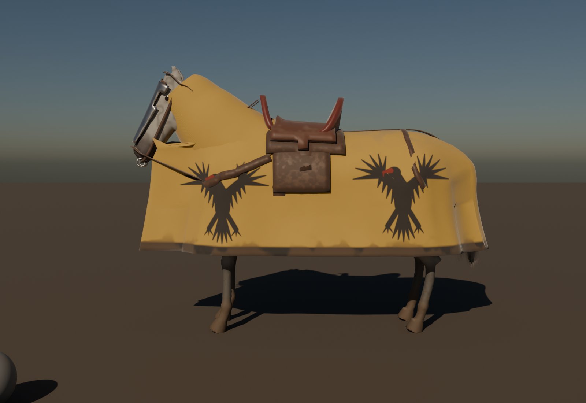

# Destrier (#402, part of #400): living war horse with tack and barding

Made 2026-11-01 by `checkking (Claude)`. Original procedural work (`../source/`), built on TGA's #155 horse pipeline
(`assets/tga/HalfHorseZombie/source`). Research: [`handoffs/cavalry-400/RESEARCH.md`](../../../../handoffs/cavalry-400/RESEARCH.md) §2–3.

## What's here

| File | What |
|---|---|
| `SK_Destrier.fbx` | Horse, 36k tris + 742 hair cards, 30 bones (incl. the RiderSocket and lance socket bones), 6 anims. Slots `M_DestrierCoat`, `M_DestrierTail`, `M_DestrierMane`. Metres, Z up, faces +Y in UE like the mannequin |
| `SK_Destrier_Tack.fbx` | Same skeleton: caparison, neck cover, war saddle (high pommel and cantle), flaps, girth, breast strap, crupper, stirrups, bridle, reins, steel chanfron. 31k tris, slot `M_DestrierTack` |
| `textures/T_Destrier_<Bay/Grey/Black>_BC / _ORM`, `T_Destrier_N` | 2K coat sets, normal shared (DirectX) |
| `textures/T_DestrierHair_<Skin>_BCA` | Hair card atlas (8 clump columns, alpha) |
| `textures/T_DestrierTack_BC / _ORM / _N` | 4K tack atlas |

The UE import for everything (horse, tack, lance, rider legs) is `../import_cavalry_ue.py`.

## Decisions (research §2–3)

- **15 hands (1.52 m at the withers).** Medieval warhorses were small by modern standards (Exeter, 1,964 bones):
  compact, deep-chested, crested stallion neck, not a Shire.
- **Barding v1 = cloth caparison + steel chanfron.** The caparison is shrink-wrapped over the body, then hung straight
  down from its widest line to a hem at 0.62 m (cloth hangs, it doesn't hug the belly). The arms: **Or, an eagle sable**
  (the Yellow Eagle set): two eagles per flank (shoulder and hindquarter), facing the head on both sides, black hem band.
  Plate crinet / peytral is a v2 option.
- **War saddle with a high pommel and cantle** (museum saddles: the cantle stops the knight being pushed off by the
  lance hit), on top of the caparison as on real ones.
- **Mane hidden on barded horses:** set slot `M_DestrierMane` to `M_CavalryInvisible` (the neck cover goes over it).

## Animations (30 fps, in place)

| Clip | Frames | Use |
|---|---|---|
| `A_Destrier_Idle` | 90, loop | breathing, looks round, paws once, rests a hind hoof, ears move; lance upright |
| `A_Destrier_Walk` | 36, loop | 4-beat walk, head nods twice per stride |
| `A_Destrier_Trot` | 20, loop | 2-beat diagonal trot with suspension |
| `A_Destrier_Gallop` | 18, loop | transverse gallop, neck stretched, ears pinned, **lance couched** across the neck |
| `A_Destrier_Rear` | 36, one-shot | rears; forehooves strike on **frame 22** |
| `A_Destrier_Death` | 45, one-shot | legs buckle, falls on its right side |

Speeds that match the strides (±20 % play rate max, INDUSTRY_SECRETS 3.4): walk ~1.7 m/s, trot ~3.5 m/s, gallop
~7.5 m/s at rate 1.0 (charge 9 m/s = rate 1.2).

## Values (pbr_check, all OK — `pbr_check.txt`)

| Set | non-metal p5/p50/p95 sRGB | roughness p5/p95 |
|---|---|---|
| Bay | 50 / 70 / 76 | 0.53 / 0.80 |
| Grey | 73 / 146 / 159 | 0.51 / 0.80 |
| Black | 39 / 43 / 72 (dark natural coat floor ~40) | 0.47 / 0.80 |
| Tack | 42 / 140 / 150; steel 193, metallic 0/1 | 0.50 / 0.95 |

Every layer has a cause: black points and a paler belly, a darker topline, the bare dark muzzle skin, wet glossy eyes,
sweat (darker, glossier) at the neck, behind the elbow and between the hind legs, mud splashed up the legs and the
caparison hem by the hooves, dust settled on top, darker damp cloth under the saddle. Wool roughness 0.85–0.95
(INDUSTRY_SECRETS 1.1), steel all variation in roughness (3.3).

Lookdev: Cycles, Nishita sky, sun 35°, grey ball metered on its sun side to 118 sRGB → **EV locked at −5.34** for
every exterior render.

## Known limits (v1)

- Lofted anatomy reads as a horse at gameplay distance, not as a hero close-up (head and leg detail are simplified,
  coat is a normal-map, not fur). For close cinematics, a sculpted or scanned horse is the next step (needs the
  owner's OK to buy or download).
- The caparison is skinned, not simulated: at the gallop the skirt follows the legs. Chaos Cloth on the skirt is a v2.
