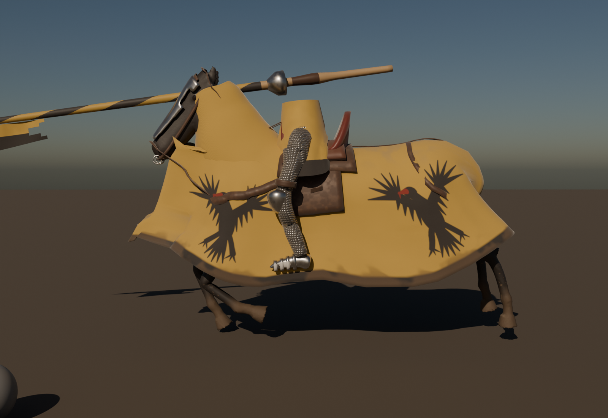

# Cavalry knight kit (#403, part of #400)

Made 2026-11-01 by `checkking (Claude)`. Original procedural work (`../source/build_knightkit.py`).

## The idea

A mounted knight = **the game's own soldier knight** (upper body) + these pieces, so the cavalry look matches the army
and nothing licensed is copied:

| Piece | How it's built |
|---|---|
| `SK_Destrier_Lance` | 3.4 m ash lance painted in the arms (yellow/black spiral), leather grip, steel vamplate, leaf head, swallowtail pennon per pale Or and sable. **Skinned 100 % to the destrier's `lance` bone**, so the horse's anims move it: upright in idle / walk / trot, couched across the neck in the gallop. No socket-axis guesswork |
| `SK_Destrier_RiderLegs` | Long-stirrup war seat: mail chausses (4-in-1 ring texture), plate knee cops, sabatons in the stirrups, garter straps, and a **surcoat skirt in the arms** that hides the join with the soldier's upper body. Skinned to `spine_01` (rides the saddle) |
| The knight's upper body | The soldier's own skeletal mesh, attached to bone `RiderSocket` with its legs hidden (`HideBoneByName thigh_l / thigh_r`), like TGA's half-horse torso. Done in the #404 Blueprint |

Both meshes use the destrier skeleton: in the Blueprint, `SetLeaderPoseComponent(Mesh)` on each.

1K textures, `pbr_check` OK: lance non-metal 43/143/147 sRGB, steel 194; legs non-metal 42/80/150, steel 191
(mail ring crowns metallic 1, holes metallic 0: INDUSTRY_SECRETS 3.3).

Decision: no new helm or shield: the soldiers already carry the Yellow Eagle look (shield paint `M_Shield_Paint_AAA`);
the surcoat skirt and lance carry the arms. A great helm can be added later as a rigid piece on the soldier's head bone.

UE import: `../import_cavalry_ue.py` (one script for horse, tack, lance and legs).
