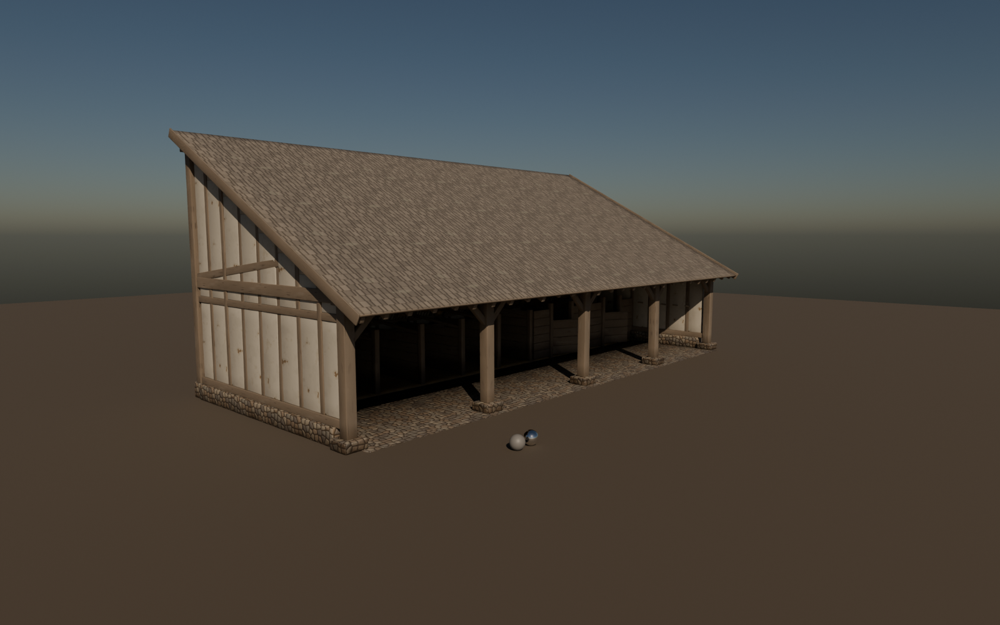

# Stables (#401, part of #400): medieval timber stable range

Made 2026-11-01 by `checkking (Claude)`. Original procedural work (`../source/`), no third-party assets.
Research: [`handoffs/cavalry-400/RESEARCH.md`](../../../../handoffs/cavalry-400/RESEARCH.md) §1.



## What it is

A lean-to stable range, **16 × 7 m**, built the way the surviving evidence says (Veselí, Manorland pad-stones and
gullies, the Warhorse project):

- Oak frame on **pad-stones**: 5 front posts (eaves 3.0 m), 5 back posts (6.4 m), plates, tie beams, raking struts,
  knee braces, rafters every 0.6 m. Riven-oak **shingle** roof at 28° with a 0.8 m overhang.
- Back and side walls: sill on a rubble plinth, studs + mid rail, **limewashed wattle-and-daub** panels (12 cm,
  Lumen-safe), INDUSTRY_SECRETS rule 4 (castles were whitewashed).
- **6 standing stalls** 1.6 × 3.0 m (kicking boards, heel posts, top rail rising to the manger) and **2 loose boxes**
  3.2 × 3.2 m with half doors on iron strap hinges, for the destriers.
- **Manger** and slanted **hay rack** along the back wall, iron tie rings, straw bedding, a cobbled walk with a
  **drain gully** behind the horses, tack pegs by the boxes.

163k tris, one mesh, Nanite. Pivot = front-left corner on the ground; open front = +Y in UE; the back wall goes against
the curtain wall. 21 UCX collision boxes (posts, walls, stall partitions, box fronts).

## Materials

6 slots, each a **2 m tiling 2K set** (1024 px/m): `Oak`, `Daub`, `Shingle`, `Straw`, `Cobble`, `Iron`.
BaseColor sRGB, ORM (R AO, G roughness, B metallic), Normal DirectX.

The big wear is **not** in the tiles but in the vertex colour `Wear`, so no stain repeats:
- **R = AO** (Cycles bake, 1.2 m reach)
- **G = wet muck**: splashed up the bottom 30–50 cm of every board (higher inside the stalls), urine behind each
  standing horse, the gully. Wet dung is dark and glossy: colour → lerp(base, lerp(base², muck, 0.5)), roughness → 0.35.
- **B = sun bleach** on up- and out-facing unoccluded faces near the open front and the whole roof top.

`pbr_check` (all OK, see `pbr_check.txt`):

| Set | non-metal p5/p50/p95 sRGB | roughness p5/p95 |
|---|---|---|
| Oak | 95 / 105 / 111 | 0.69 / 0.89 |
| Daub (limewash ~0.43 linear) | 165 / 171 / 173 | 0.76 / 0.95 |
| Shingle | 68 / 103 / 116 | 0.73 / 0.92 |
| Straw | 93 / 125 / 159 | 0.54 / 0.74 |
| Cobble | 54 / 107 / 132 | 0.48 / 0.70 |
| Iron | oxide 67–73, bare metal 192, metallic 0/1 | 0.78 / 0.89 |

Lookdev: Cycles, Nishita sky, sun 35°, 0.18 grey ball metered to 118 sRGB on its sun side (EV **locked at −5.34** for
every exterior shot), AgX; the interior is its own light zone (metered on a ball inside, rule 10). Renders in `renders/`.

## Unreal (Master)

```
py "<repo>/assets/checkking/Cavalry/Stables/import_stable_ue.py" --dry-run
py "<repo>/assets/checkking/Cavalry/Stables/import_stable_ue.py"
```

New assets only, under `/Game/CastleDefender/Environment/Stables`: `SM_Stable`, 18 textures (BC Sharpen4 mips, ORM
masks with **Composite Texture** = the normal map, N BC5), `M_StableTile` + `MI_Stable<Set>` with `MuckStrength`,
`SunStrength`, `Wetness` (hook the weather's rain to Wetness later). Placement after the owner's OK.

Props that already exist and fit inside: TGA's `SM_WaterTrough` and `SM_Bucket` (`assets/tga/Trough`).

## Rebuild

```
blender -b --factory-startup -P source/tex_stable.py -- <tex dir> 2048
blender -b --factory-startup -P source/build_stable.py -- <out dir>
blender -b <out dir>/stable.blend -P source/lookdev_stable.py -- <tex dir> <out.png> 34|inside|close|front [exposure]
```

Known limits (v1): hay in the rack is lumps, not strands; the straw bed is a texture on a lumpy slab (fine at
gameplay distance). Add straw cards if the camera goes into a stall.
