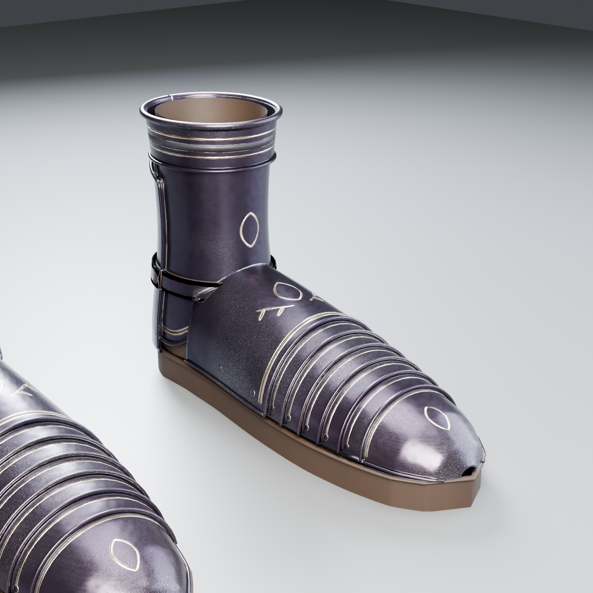

# Obsidian Sovereign: Boots L/R (sabatons, AAA by checkking)

New piece of the set, made 2026-10-28 to match the [chest](../Chest/README.md), [shoulders](../Shoulders/README.md) and [gauntlets](../Gauntlets/README.md). Built procedurally in Blender 4.5 (`source/build_boots.py`), baked from a dense high poly to a **14,075-triangle game mesh per boot**. Codex's boots stay in `assets/Codex/Obsidian-Sovereign/Boots` for comparison.

## Construction

| Part | What it is |
|---|---|
| Toe cap | pointed (late-gothic) cap with side rims, gold double border + etched band, small gold lozenge |
| 5 foot lames | articulated plates over the foot, each one over the one toward the toe, rolled toe-ward edges, a gold line each, **sliding rivets** at both ends |
| Instep plate | tall plate up to the ankle with rolled edges, gold lozenge + laurel sprays, gold/etch border, 4 rivets |
| Ankle plate | front + sides, dips down over the instep, rolled bottom edge, gold border + lozenge |
| Heel counter | wraps the heel up to the top band, rolled top edge, gold line, rivets |
| Top band | rolled-edge ring where the greave overlaps, double gold lines + etched band |
| Ankle strap | leather strap with a **steel buckle on the outer side**, strap holes |
| Shoe + sole | leather upper and ankle sock under the plates, leather sole with a **stitched welt** |

Surface: the set's **v2 material** (same as the chest v2): blackened steel with blue-violet temper, hammer marks, polish/scratch roughness, worn bright edges, grime in cavities, antique gold in the recesses, leather grain.

## Files

- `SM_ObsidianSovereign_Boots_L.fbx`, `_R.fbx`: game meshes, metres, Z up, facing -Y, **in the Codex set's frame** (left boot on +X, sole on the ground, top at 0.245 m where the greave overlaps). R is an exact mirror of L and shares its UVs and textures. Static, not skinned.
- `textures/`: 4K `T_ObsidianSovereign_Boots_BaseColor` (sRGB), `_ORM` (R = AO, G = roughness, B = metallic), `_Normal_DirectX` (16-bit).
- `import_boots_ue.py`: UE 5.3 import: both meshes, 3 textures with the right settings, `MI_ObsidianSovereign_Boots` on the shared `M_ObsidianSovereign` master (made if missing).
- `renders/`: baked game mesh, Cycles (front 3/4, side, back 3/4, top).
- `source/`: `build_boots.py` (all parts), `bake_staged.py` + `run_bake.ps1` (build r1/r3 -> prep -> 4K bake in quarters -> finish), `render_boot.py`, `uvcheck.py`, `bounds_codex.py`. Uses `../Chest/source/chestlib.py`, `../Gauntlets/source/gauntletlib.py` and `../Chest/source/materials.py` (paths inside are the old PC's: see `handoffs/checkking-session/HANDOFF.md`).

## Still open

- Fit + skinning to `ShadowknightUE_SK` (like the chest: the Vice fitted that one in Blender on the owner's PC) and hiding the knight's own feet/greaves under them.
- The ankle strap bakes quite dark (thin strip, check it in engine; `tools/fix_straps.py` is the fix if it shows stray texels).
- Works together with the new shins (greaves, baking next), whose bottom flares over the top band.
