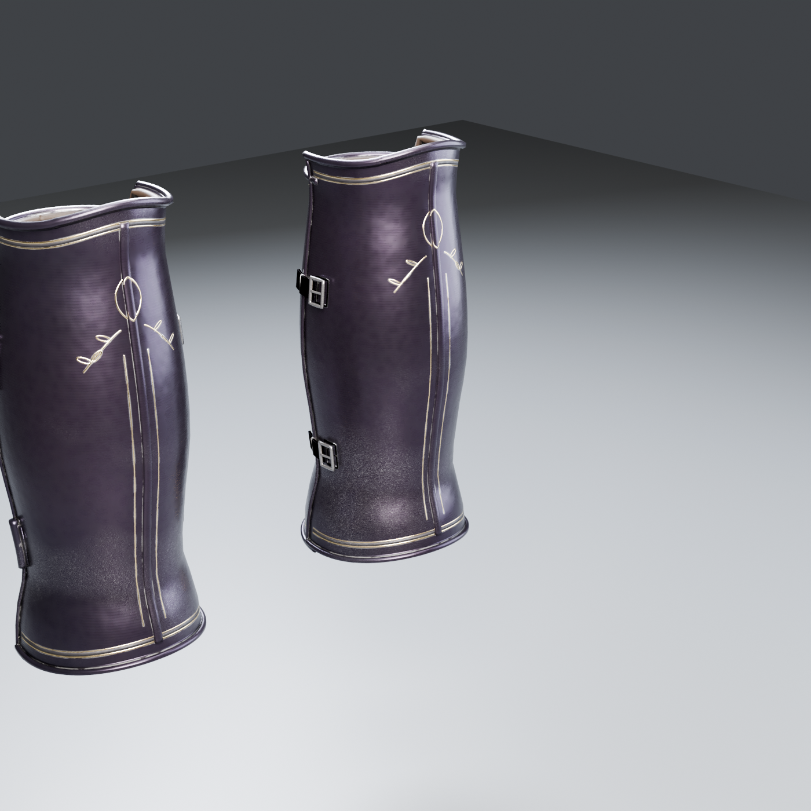

# Obsidian Sovereign: Shins L/R (greaves, AAA by checkking)

New piece of the set, made 2026-10-28 to go with the [boots](../Boots/README.md) and match the [chest](../Chest/README.md). Built procedurally in Blender 4.5 (`source/build_shins.py`), baked from a dense high poly to a **10,768-triangle game mesh per leg**. Codex's shins stay in `assets/Codex/Obsidian-Sovereign/Shins` for comparison.

## Construction

| Part | What it is |
|---|---|
| Front shell | shin plate with a **medial ridge (keel)** down the front, top edge peaks under the knee cop, bottom flares over the boot's top band |
| Back shell | calf plate, lower at the back of the knee for the bend; the front shell overlaps it at both sides |
| Edges | **rolled edges** top and bottom on both shells, side rims on the front shell, a **leather lining roll** showing at the top |
| Hinges | 2 hinge barrels with leaves and rivets on the **outer side** (+X for the left leg) |
| Straps | 2 leather straps with **steel buckles on the inner side**, riveted to the back shell |
| Ornament | double gold borders with etched bands under the top and above the bottom, **gold lozenge + laurel sprays under the knee**, fine gold lines either side of the ridge |

Surface: the set's **v2 material** (same as the chest v2 and the boots).

## Files

- `SM_ObsidianSovereign_Shins_L.fbx`, `_R.fbx`: game meshes, metres, Z up, facing -Y, **in the Codex set's frame** on the boot's leg axis (x 0.135 for the left leg), bottom at 0.207 m (over the boot's top band), top at 0.545 m (under the knee, where Codex's thighs start). R mirrors L, shared UVs and textures. Static, not skinned.
- `textures/`: 4K `T_ObsidianSovereign_Shins_BaseColor` (sRGB), `_ORM` (R = AO, G = roughness, B = metallic), `_Normal_DirectX` (16-bit).
- `import_shins_ue.py`: UE 5.3 import: both meshes, 3 textures, `MI_ObsidianSovereign_Shins` on the shared `M_ObsidianSovereign` master.
- `renders/`: baked game mesh, Cycles (front 3/4, side, back 3/4, inner side).
- `source/`: `build_shins.py`, `bake_staged.py` + `run_bake.ps1`, `render_shin.py`, `with_boot.py` (renders the greave on the boot to check the fit).

## Still open

- Fit + skinning to `ShadowknightUE_SK` (with the boots), hiding the knight's own lower legs under them.
- The straps bake dark (same as the boot strap); check in engine.
- The knee cop (poleyn) belongs to the thighs piece, next in line.
