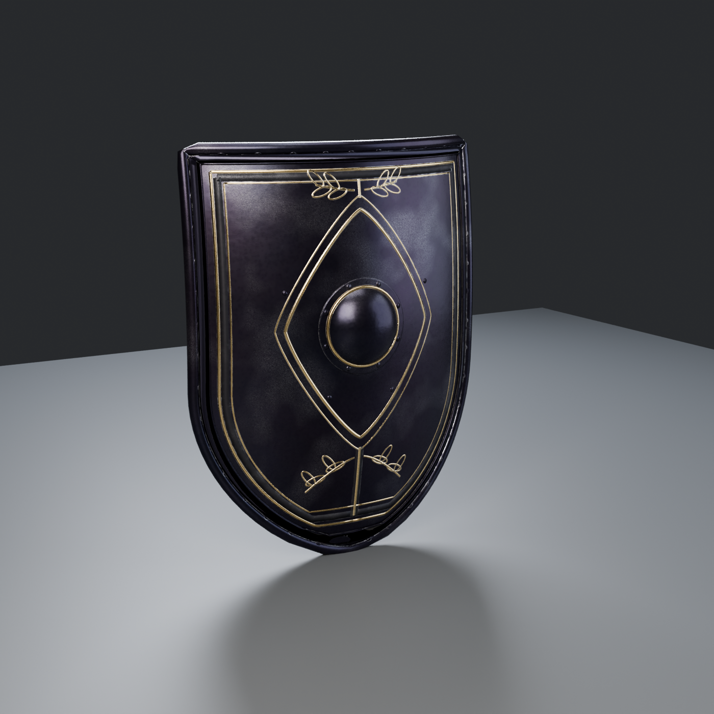

# Obsidian Sovereign: hand shield (#96 item 30)

The shield from the #96 spec (`handoffs/obsidian-set-bonus-96/SPEC.md`): its **own item**, bought and upgraded at
Vesna on its own and **not part of the armour set**. Made 2026-10-28 by `hossam gmail laptop2 (Claude)` with
checkking's pipeline (the chest's `chestlib.py` helpers and the set's **v2 material**, `materials.py`), so it matches
the chest, shoulders, gauntlets, boots and greaves. About 20.6k triangles, 4K textures.

## Construction

| Part | What it is |
|---|---|
| Face | heater shield, 0.78 m tall x 0.60 m wide, curved face (more across than along), 4.5 mm blackened steel |
| Rim | rolled steel rim all round, an applied edge band inside it with **rivets** every ~6 cm |
| Boss | domed centre boss with a flat flange, a gold ring and 8 rivets (the **Bulwark Rune** VFX sits here, see SPEC.md 4) |
| Gold inlay | double border with an etched band between, the **sovereign lozenge** around the boss, a pale (vertical line) to the point and to the top, two pairs of **laurel** sprigs |
| Back | leather covering, a padded **forearm strap** (enarme) and a leather-wrapped **hand grip**, with riveted ends (their heads show on the face) |

## Files

- `SM_ObsidianSovereign_Shield.fbx`: game mesh, metres, Z up, the face looks toward -Y, the point at z 0, centred on x 0. Static.
- `textures/`: 4K `T_ObsidianSovereign_Shield_BaseColor` (sRGB), `_ORM` (R = AO, G = roughness, B = metallic), `_Normal_DirectX` (16-bit).
- `import_shield_ue.py`: UE 5.3 import: mesh, 3 textures with the right settings, `MI_ObsidianSovereign_Shield` on the shared `M_ObsidianSovereign` master (made if missing), in `/Game/CastleDefender/Characters/Hero/Armor/ObsidianSovereign/Shield`.
- `renders/`: the baked game mesh in Cycles (front 3/4, front, back 3/4, side).
- `source/`: `build_shield.py` (all parts), `bake_staged.py` + `run_bake.ps1` (build r1/r3 -> prep -> 4K bake in quarters -> finish), `render_shield.py`. **No hard-coded paths:** copy `source/` plus `../../../checkking/Obsidian-Sovereign/Chest/source/chestlib.py` and `materials.py` into one short folder (Blender can't open paths over 260 characters) and run `powershell -File run_bake.ps1`. It needs ~1.5 GB free and deletes its raw EXRs at the end.

## In game

- Attach to the hero's left hand/forearm with a socket (e.g. `shield_l` on `hand_l`). The grip is at about
  (0, +0.04, 0.32) in mesh space, and the forearm strap at z 0.52.
- The Bulwark Rune VFX from SPEC.md 4 is an Overlay Material centred on the boss (z 0.45). It's not built yet.

## Still open

- Socket fit on the knight in the editor (Master).
- Shield item, buy/upgrade at Vesna, block logic: SPEC.md 4 (needs the HUD exports requested on #96).
