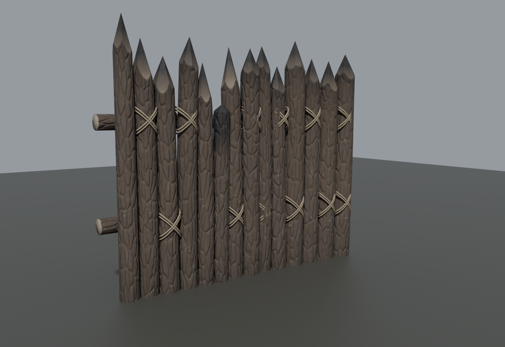
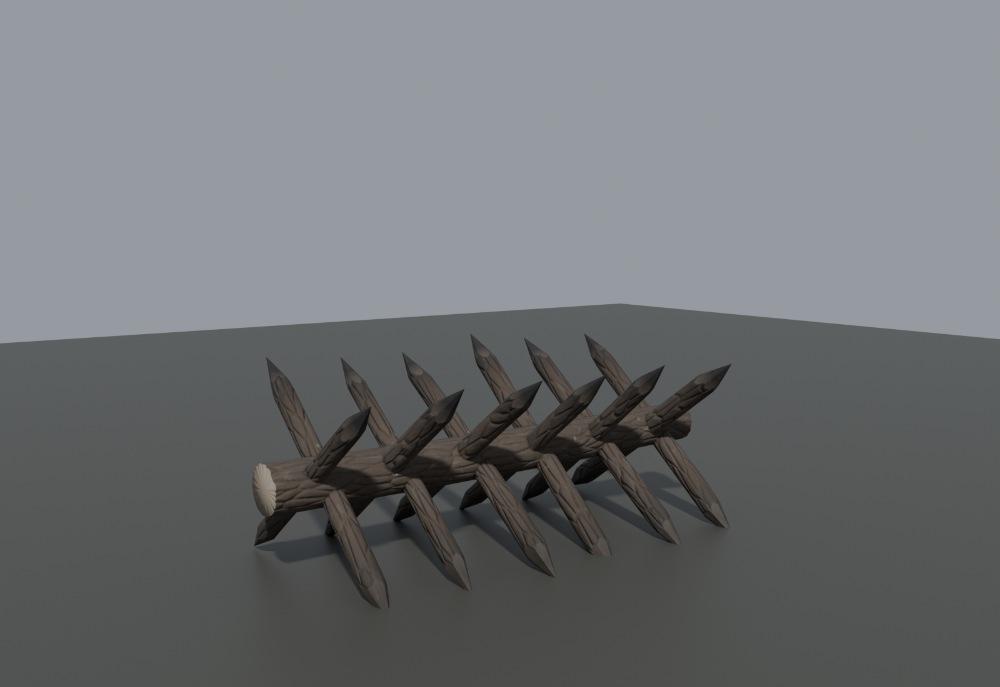
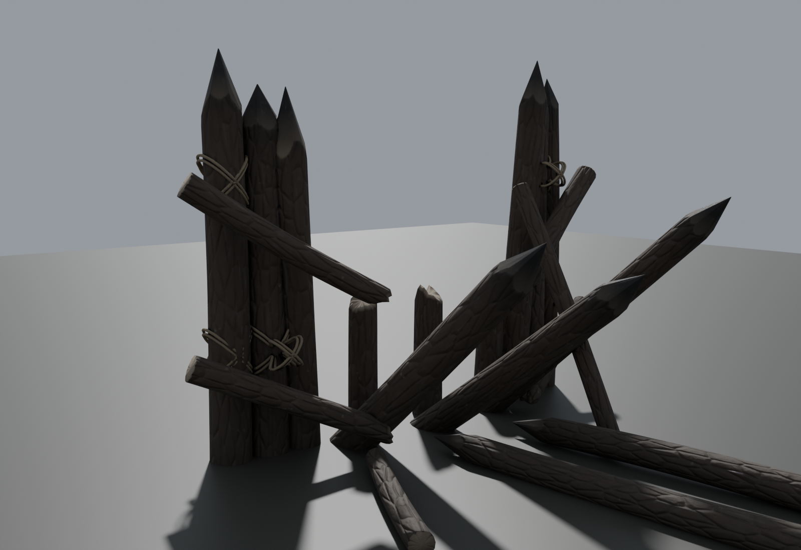

# Siege barricade kit: fire-hardened palisade + cheval de frise (#29 player boundaries)

Made 2026-10-29 by `hossam gmail laptop2 (Claude)`. These are the "block" layer of the #29 boundary plan
(`handoffs/player-boundaries-29/PLAN.md`). The edge of the playable ground reads as a wall the defenders built
against the fog, not an invisible wall. **Original work, procedural, no third-party assets**, so it's safe in the
public repo.

## Pieces

| Mesh | Size | Tris | What it is |
|---|---|---|---|
| `SM_SiegeBarricade_Palisade` | 4.0 m wide, 2.6-3.5 m tall, 1.8 m deep with its braces | 46,140 | About 13 pine posts packed edge to edge, sunk 0.25 m, axe-pointed and fire-hardened (charred) tips; one post snapped and burnt lower down. Two rails at the back, X-lashed with hemp rope; two diagonal braces. |
| `SM_SiegeBarricade_Cheval` | 3.6 m long, ~1.4 m tall | 10,192 | A cheval de frise: an axle log bored through by 12 crossing stakes, both ends pointed and charred. |
| `SM_SiegeBarricade_Breach` | 4.0 m wide, same posts | 25,008 | The palisade smashed inward by the horde: the outer posts stand (the two at the hole lean away), the middle ones are snapped into splintered stumps, knocked over or lying flat inside; both rails broken with sagging ends. **The gap is passable**, so put one on every zombie spawn lane. |

## Detail

- **Bark:** baked from a 2.2M-vertex source with real pine-bark geometry: big uneven plates split by deep
  V-fissures, minor cracks and flaky layers. Weathered silver on the high points, damp and dark in the fissures,
  grey-green lichen low down.
- **Wood:** axe-faceted points with grain and annual rings. Old cuts have gone grey.
- **Char:** a scorched fringe, then charcoal with alligator cracks and ash.
- **Ground:** a wet-earth splash line up the first 0.6 m, so every post seats into the ground.
- **Textures:** 4K `BaseColor` (sRGB), `ORM` (R = AO, G = roughness, B = metallic = 0), `Normal_DirectX` (16-bit).
  Texel density is equal on every log.
- **Convention:** metres, Z up, the face looks toward -Y, the base at z 0 (posts go to z -0.25 so they bury into
  slopes).

## Unreal

`import_siegekit_ue.py` imports both into `/Game/CastleDefender/Environment/Boundaries/SiegeKit`:
- textures with the right settings
- a shared `M_SiegeBarricade` master with `Tint` and a `Wetness` slider (darker, glossier wood for rain or fog)
- `MI_` instances
- **4 LODs** (100 / 50 / 25 / 10 %) and one **simple box collision** each, which blocks the hero and the camera
  without snagging on stakes

Place them in rows with HISM (instanced) for the boundary lines:
- random yaw ±8°, scale 0.9-1.15
- overlap the palisade pieces by about 0.3 m and stagger the rows
- put a cheval in front of every palisade gap and breach

## Source

Everything needed to rebuild, or to make new variations, is in `source/`:
- `build_kit.py`: low and high meshes, from numpy
- `woodmat.py` + `matlib.py`: the procedural PBR
- `bake_kit.py` + `run_kit.ps1`: staged 4K bake
- `clay.py`: renders

Copy `source/` into a short folder (Blender can't open paths over 260 characters) and run
`powershell -ExecutionPolicy Bypass -File run_kit.ps1 -Assets Palisade`, then run it again with `Cheval`. It needs
about 2 GB free and deletes its raw EXRs at the end.
