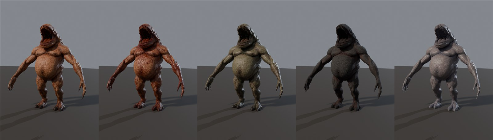

# Flesh Brute: new heavy enemy, 5 skins

Made 2026-10-29 by `TGA (Claude)`, owner's pick. It's a 2.3 m flesh mutant with a split maw, for later waves: slow,
tanky, and it breaks the zombie silhouette.



Left to right: **Clean**, **Bloody** (the artist's two skins), then **Rotten**, **Charred** and **Drowned**, which TGA
made from the artist's maps.

## Licence: the model files are private

The source is CGTrader "Flesh Mutant Monster" by andrey-ryzhko, under a **Royalty Free licence (no AI)**. It's fine
to use in the game, but **don't put the FBX or textures in this public repo**. Only this README, the import script
and the preview renders are here.

### Starting from the original download (owner request 2026-10-31, #229)

The Master buys and downloads the model himself. Only TGA's changes are in this repo.

1. **Product:** "Flesh Mutant Monster" by **andrey-ryzhko**: game-ready, two skins (clean / bloody), 4K PBR, files BLEND + FBX + an Unreal project, 29,703 polygons.
   - It was bought on CGTrader. The same model by the same artist is listed at https://www.renderhub.com/andrey-ryzhko/flesh-mutant-monster.
   - Use the owner's own purchase.
2. **Files needed from the download** (extract it anywhere):
   - `Monster_001_FBX/Monster_001.fbx`
   - from `Monster_001_TEXTURES/Monster_001_Textures/skin_01/`: part_01 and part_02 `BaseColor`, `AO`, `Roughness` and `Normal_DirectX` (4K PNGs)
   - from `skin_02/`: part_01 and part_02 `BaseColor` and `Roughness`

   The UE 5.8 project, the .blend file, the Metallic maps and the OpenGL normal maps are not needed.
3. **Re-apply TGA's changes:**
   ```
   blender -b -P assets/tga/FleshBrute/source/prepare_from_download.py -- "<extracted download>" "C:\Unreal Backups\Castle Defender\Tools\PrivateExports\2026-10-29\flesh-brute"
   ```
   - **Mesh and rig: no changes.** `SK_FleshBrute.fbx` is the artist's `Monster_001.fbx` byte for byte, renamed only. The script checks the SHA-256. Scale (cm), pivot, A-pose, the 86 bones and the 2 material slots are the artist's.
   - **Textures:** `make_skins.py` writes the 5 skins × 2 parts (Clean and Bloody with the realism pass, plus Rotten, Charred and Drowned) and the 2 normal maps: 22 PNGs.
   - Tested on the real download: 22 textures + the FBX.
4. **Import into Unreal:** run `import_fleshbrute_ue.py` (below). It creates the material, the 10 MIs and the default skin.

The old route still works: unzip `FleshBrute_PRIVATE.zip` to the same folder.

The model's own UE package is built for **UE 5.8**, so it can't be opened in our 5.3 project. Use the FBX route below.

## The model

| | |
|---|---|
| Mesh | 58,626 tris, 2 material slots (P01 body, P02), 2.28 m tall, A-pose, cm units |
| Skeleton | 86 bones, single `root`, UE-style names (`spine_01..04`, `neck`, `head`, `jaw`, `tongue_01..03`, `upper_arm_01..03.L/R`, `forearm_01..03`, `hand`, fingers, `thigh_01..02`, `shin_01..02`, `foot`, `toe`), plus jiggle bones `belly.C/L/R`, `side.L/R`, `breast.L/R`, `butt.L/R` |
| Textures | 4K per part: BaseColor (sRGB), ORM (R AO, G roughness, B metallic 0), Normal (DirectX, shared by all skins) |

## Skins

- **Clean:** the artist's own skin.
- **Bloody:** the artist's own skin.
- **Rotten:** desaturated olive and grey-green, rot black in the cavities, mottled bruise patches, slightly wetter.
- **Charred:** raised skin burnt to black char with ash on the highest points; raw red flesh in the deepest folds. Dry, with rough char and glossy cracks.
- **Drowned:** pale, cold blue-grey, darker blue-purple folds, glossy and wet. Its MI sets `Wetness` to 0.5.

The masks come from the artist's own AO, colour and normal-map curvature, so the variants don't break at UV seams.
The generator is `source/make_skins.py` (Blender 5.2, numpy).

**Realism standard pass (2026-10-29, `handoffs/laptop2-realism/STANDARD.md`):** all 10 BaseColor/ORM pairs pass
`tools/laptop2/pbr_check.py`. Before the pass:
- Charred was 74 % below 30 sRGB. Its char is now charcoal at about 38-50 sRGB.
- Even the artist's Clean and Bloody had 16-31 % crushed blacks. A soft dark floor on every skin lifts only the darkest
  tones to about 36 sRGB.
- Roughness was flat on three P02 maps. It now varies at three scales (skin detail, noise, mottling), with wetter
  cavities.

The private zip has the new maps.

## Unreal (Master)

1. **Import.** Run `py "<repo>/assets/tga/FleshBrute/import_fleshbrute_ue.py"`. It creates
   `/Game/CastleDefender/Characters/Enemies/FleshBrute/`:
   - `SK_FleshBrute`, its skeleton and physics asset
   - the textures
   - `M_FleshBrute`
   - 10 MIs (`MI_FleshBrute_<Skin>_P01/_P02`)

   The Clean skin is assigned by default. `M_FleshBrute` has the same parameter names as the zombie skin master
   (`Tint`, `TintAmount`, `Wetness`, `HitT`), so the existing per-spawn tint and hit-flash code can drive it.
2. **Animations by retarget.** The FBX has none.
   - Make `IKR_FleshBrute` with these chains: Spine `spine_01-spine_04`, Neck/Head `neck-head`, Arm L/R
     `upper_arm_01-hand`, Leg L/R `thigh_01-foot`; retarget root `root`.
   - Use the zombie's IK Rig as the source, or make one the same way.
   - Make `RTG_Zombie_to_FleshBrute` and batch-retarget the zombie walk, run, attack, hit and death anims.
   - The brute is wider and heavier, so in the retargeter raise the pelvis about 5 cm and spread the arm chains
     about 10° so the hands clear the belly.
3. **Gameplay.** This is a suggestion; the owner can adjust it.
   - Duplicate `BP_Zombie` as `BP_FleshBrute` and swap the mesh and anim class.
   - Capsule radius 55, half height 118.
   - HP ×4, walk speed ×0.65, damage ×2, knockback immune.
   - Pick a random skin on spawn, the same way `BP_ZombieVariety` does.
   - Spawn 1-2 per wave from wave 6.
   - Optional: drive `jaw` open on the attack anim, and add an AnimDynamics node on `belly.*` for the jiggle.

**Done:** in Play, a Flesh Brute walks and attacks with the retargeted zombie anims, and its skin varies per spawn.
