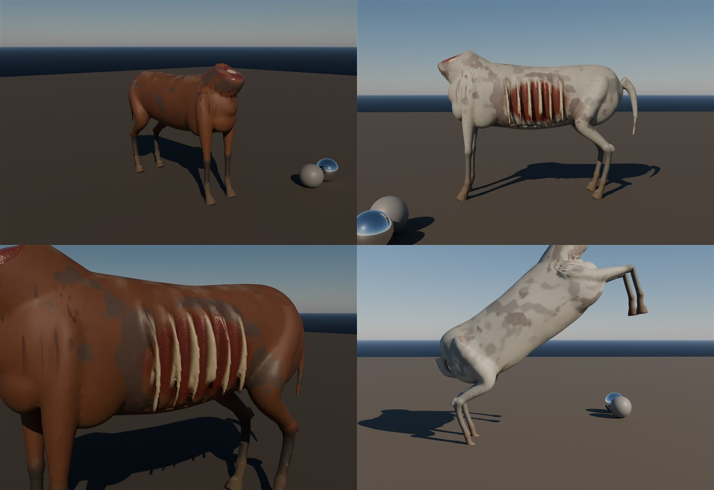

# Half-horse zombie: the rotting horse body (#155)

Made 2026-10-30 by `TGA (Claude)`. It's the lower half of the realm's half-horse zombie: a starved, rotting horse
carcass. The rib cage shows through a wound on the left flank, and the neck is torn off. The existing zombie torso
(`SK_Zombie`, licensed, already in the project) sits on the neck stump at the **`TorsoSocket`** bone.
**Original procedural work with no third-party assets, so everything is in this repo.**

## What's here

| File | What |
|---|---|
| `SK_HorseBody.fbx` | Skeletal mesh + 5 anims. 30k tris, 25 bones, 1 slot (`M_HorseBody`). 2.3 m long; the withers are about 1.5 m and the socket is at 1.6 m. Metres, Z up, faces +Y in UE like the mannequin |
| `textures/T_HorseBody_<Skin>_BC / _ORM` | 4K. BaseColor is sRGB. ORM: R = AO, G = roughness, B = metallic 0 |
| `textures/T_HorseBody_N` | 4K normal, DirectX, shared by both skins |
| `import_horsebody_ue.py` | Editor import: textures, mesh, anims, material + MIs, the `TorsoSocket` socket |
| `source/` | The Blender scripts that rebuild it |

## Skins

- **Bay:** dark red-brown coat, black points (lower legs), paler belly.
- **Grey:** dappled grey, darker points.

Both have the same rot, and every layer has a physical cause (`handoffs/knowledge`):
- mange where the dried hide split
- wet dark flesh and bone-white ribs in the flank wound
- a torn neck stump with a vertebra at its centre
- dried blood running **down** from both wounds
- mud splashed up the legs, thick on the hooves
- dust settled on the back

Calibrated values: non-metal albedo 30-240 sRGB, metallic 0, roughness varied at three scales, no light in the
BaseColor. `pbr_check` results:

| Skin | BaseColor p5/p50/p95 | Roughness p5/p95 | Result |
|---|---|---|---|
| Bay | 50 / 69 / 101 sRGB | 0.39 / 0.82 | OK |
| Grey | 71 / 134 / 153 sRGB | 0.39 / 0.82 | OK |

Texel density is 1,240 px/m (the close-prop baseline is 1,024).

**Known limit:** the coat is hair-stroke detail in the normal map, not fur cards. It reads as hide and coat at gameplay distance but as smooth hide up close. Add a groom or shell-fur pass only if the camera gets that close.

## Animations (30 fps; the root sits on the ground)

| Clip | Frames | Use |
|---|---|---|
| `A_HorseBody_Gallop` | 18, loop | the charge: transverse gallop, about 3.3 strides/s |
| `A_HorseBody_Walk` | 36, loop | 4-beat walk |
| `A_HorseBody_Idle` | 60, loop | breathing; it paws the ground once and rests a hind hoof |
| `A_HorseBody_Rear` | 36, one-shot | the knock-down: it rears and slams the forehooves down. **Impact on frame 22** |
| `A_HorseBody_Death` | 45, one-shot | the legs buckle and it falls on its right side, wound up; legs stiff |

## Unreal (Master)

1. Run `py "<repo>/assets/tga/HalfHorseZombie/import_horsebody_ue.py"`. It creates
   `/Game/CastleDefender/Characters/Enemies/HalfHorseZombie/`:
   - `SK_HorseBody` and the 5 anims
   - `M_HorseBody`, which has the zombie skin master's parameters
   - `MI_HorseBody_Bay` / `_Grey`
   - the **`TorsoSocket`** socket. If the script can't add it, add it by hand on bone `TorsoSocket`.
2. **`BP_HalfHorseZombie`** (#155) is a suggestion.
   - Make it a child of `BP_Zombie`. The Mesh is `SK_HorseBody` (yaw -90), capsule radius 60, half height 110.
   - Add a SkeletalMeshComponent `Torso` = `SK_Zombie` (a random zombie skin MI), attached to Mesh at socket
     `TorsoSocket`. Offset it so the zombie's pelvis sits in the stump, about -95 cm in Z (tune by eye), and rotate
     yaw -90.
   - On BeginPlay call `Torso -> HideBoneByName('thigh_l')` and `('thigh_r')` (use the zombie skeleton's names). This
     hides the legs and everything under them.
   - The torso keeps its own AnimBP: idle, and arm swings on attack.
   - Movement: max walk speed ×2 of the zombie (charge with `Gallop`, `Walk` below 250 cm/s), 400 HP.
   - Knock-down attack: when a soldier is within 2 m in front, play `Rear` as a montage. On frame 22 (notify) apply
     damage and launch soldiers in a 2 m cone (LaunchCharacter about 600 forward, 300 up) so they fall.
   - Death: play `Death` on the horse and let the torso ragdoll, or play the zombie's death anim.
   - It spawns only inside the realm, or from the first breach on.

**Done:** in Play, a half-horse zombie gallops at the defenders, rears and knocks soldiers down, and dies on its side.

## Source (`source/`, Blender 5.2)

Run these in order from a short path:
1. `build_horse.py`: lofted anatomy (barrel, shoulder and hindquarter masses, chest, neck stump, 4 legs in real joint
   order, tail, ribs) → voxel remesh → Laplacian smooth → sunken wound → decimate to 30k → smart UV → rig and auto
   weights.
2. `anim_horse.py`: the 5 clips and the FBX.
3. `bake_horse.py`: data bakes (position, normal, AO), then numpy makes the 2 skins and the normal map. About 15 min
   at 4K.
4. `lookdev_horse.py`: calibrated lookdev (`SKIN`, `VIEW`, `SUNROT`, `POSE`, `FRAME`).
