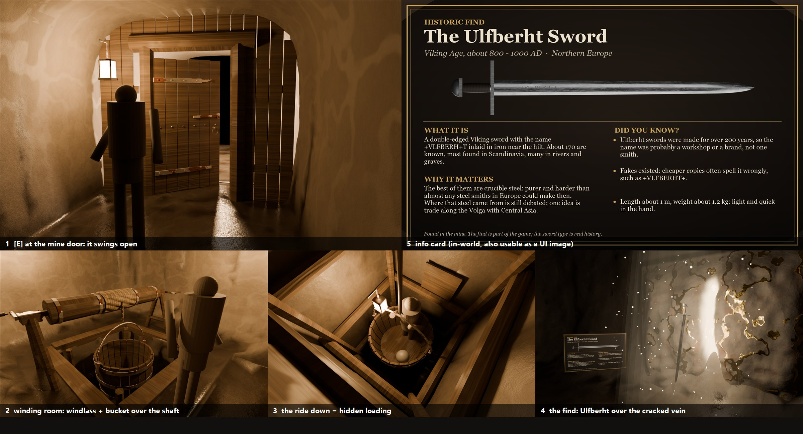

# #543 Mine door, bucket lift (the hidden load) and the historic find

Made 2026-11-06 by `TGA PC (Claude)` on the owner's order.

> *"...when you reach the mine entrance there is an actual door there and when you click E you get in a big bucket and climb down like elevator, just like medieval do, while this will be our hidden (loading bar)... he will find a floating weapon ... with vfx ... the reveal comes with an info card ... educational aspect about historical icons"*

**Original procedural work, with no third-party assets.** The binaries went to the Master by Taildrop as `MineLift543_assets_1106.zip`. This folder holds the scripts and the sources.

## How it plays

1. **The hut door.** The player walks up to Mine_01's door and sees **[E] Open the mine door**.
   - On E, a real hinged oak door swings open (0.8 s).
   - There's a 0.25 s blink as he steps into the dark. That is the only cut.
2. **The winding room.** He's standing in a medieval bucket (a *kibble*) that hangs under a hand windlass over a timbered shaft. This is how mines worked in Agricola's *De re metallica* (1556).
3. **The ride is the loading screen.**
   - The bucket lowers with the drum turning and the rope paying out. A lantern hangs on the bail, and the camera looks down past his shoulder.
   - **The swap:** after 8.5 m the hero and the camera jump to an identical shaft above the dungeon. Both shafts have 1.3 m frame spacing, and the jump happens at the height where the frames line up, at the same speed. The player never sees a cut.
   - The ride lasts 10 s in all. If the dungeon is ever made to stream in, this is the window: start loading on the first frame of the ride, and land when it's done.
4. **The dungeon.** He lands at the shaft foot, which sits in the dead end's old grid slot, and walks out into the tunnels.
   - Riding back up is the same in reverse. At the top he comes out at the hut door, and the door shuts behind him.
5. **The find.**
   - In the chamber, one ore vein is split open with a glowing cleft. An **Ulfberht sword** floats in front of it, turning slowly and bobbing, in a soft beam with sparks.
   - E shows **[E] Take the sword**. The sword, beam and sparks go, and the **info card** appears.
   - The card hides when he walks 6 m away.

**Why an Ulfberht?**
- **Real and famous:** about 170 survive from the Viking Age, c. 800-1000 AD.
- **Fits a mine:** the best were crucible steel, purer than almost anything European smiths could make.
- **Educational:** the card covers the name inlay, the steel, a Volga trade theory (marked as debated), the fakes, and its size and weight.
- **Honesty:** the card says "the find is part of the game; the sword type is real history".

## Files

| Folder / file | What |
|---|---|
| `fbx/` (15) | Metres, Z up, the kit's FBX settings (UE imports at ×100; Y is mirrored, like the kit). See "Meshes" below. |
| `textures/` | `T_Ulfberht_BC/ORM/N` (2K), `T_MineRope_BC/ORM/N` (512, tiles every 36 cm), `T_RevealNoise` (512), `T_InfoCard_Ulfberht` (2048×1280, also usable as a UI image). N is DirectX. ORM = AO, roughness, metallic. |
| `import_mine543_ue.py` | Assets, materials, Blueprint components, and the level placement. Modes are listed below. |
| `BP_MineLift_graph.txt`, `BP_MineFind_graph.txt` | The logic pastes (bpkit). |
| `VARIABLES_BP_MineLift_BPVar.txt` (17), `VARIABLES_BP_MineFind_BPVar.txt` (8), `VARIABLES.md` | The variable lines and what each one means. |
| `gen_mine543.py` | Regenerates the pastes and variable lines (needs bpkit + `tools/master/t81/kit.py`). |
| `source/` | `build_mine543.py` (meshes), `bake_mine543.py` (textures), `lookdev543.py`, `clay543.py`, `export543.py`, `make_card543.ps1` |
| `renders/` | Calibrated Cycles lookdev with the #309 kit materials: door, winding room, ride, reveal, card, and the sheet. |

### Meshes

| Mesh | Tris | Notes |
|---|---|---|
| `SM_MineGate_Door` | 2.0k | Riven oak planks, strap hinges, Z-brace on the back, ring pull, latch. **Pivot on the hinge**, and the leaf runs −Y (UE) from it, front +X. |
| `SM_MineGate_Bulkhead` | 0.9k | A plank wall that closes the 3 m kit tunnel around `SM_Mine_DoorFrame`. |
| `SM_MineShaft_Top` | 22k | The winding room: a carved rock cavity seen from inside (5 × 5.2 m room plus a dead passage), and a 2.3 m square shaft 13.2 m deep. Complex collision. |
| `SM_MineShaft_Bottom` | 16k | **Replaces `SM_Mine_Tunnel_DeadEnd` in its grid slot.** Its x = 0 face is the kit profile, so it joins the T seamlessly. It has a landing room and a shaft rising 14.6 m. |
| `SM_MineShaft_Cribbing_Top` / `_Bottom` | 1.3k / 1.1k | Oak shaft frames every 1.3 m, plus corner posts. In the bottom one the posts run down to the landing floor as guide posts. |
| `SM_MineShaft_Collar` | 1.1k | Collar beams and the windlass trestles. |
| `SM_MineWindlass_Drum` | 1.3k | Drum, bands, 2 cranks and rope turns. **Pivot on the axle (Y).** |
| `SM_MineBucket` | 5.9k | The kibble: 22 staves, 3 hoops, a bail and an eye. 1.4 m wide, pivot bottom centre. Sockets **Rope**, **Stand** (where the hero's capsule centre goes) and **Lamp**. |
| `SM_MineRope_1m` | 0.4k | 3-strand. Pivot at the bottom, and the Blueprint scales Z. The material locks the lay to world Z, so it never stretches. |
| `SM_Mine_OreVein_Cracked` | 18k | The kit's ore face split open. Vertex colour R drives the cleft glow. |
| `SM_Ulfberht` | 3.4k | Petersen type X: 90 cm blade with a fuller, 19 cm guard, leather grip, tea-cosy pommel. **+VLFBERH+T** is inlaid on the front and a lattice on the back. Point down, pivot at the balance point. |
| `SM_Reveal_LightShaft`, `SM_Reveal_Motes`, `SM_InfoCard` | 336 / 360 / 2 | The beam cone, 180 spark quads (with a per-quad phase in vertex colour R), and a 1.6 × 1 m card. |

### Materials

These are made by the script. The kit pieces reuse `MI_MineRock/Oak/Iron/Ore`.

| Material | Parameters |
|---|---|
| `M_Ulfberht` | `BobCm` 2.5, `BobHz` 0.45, `Float` 1 (set it to 0 to stop the bob) |
| `M_MineRope` | none. Its V comes from world Z relative to the pivot, at 36 cm per tile. |
| `M_RevealVein` | `GlowColor`, `GlowStrength` 8, `Reveal` 1, with a slow breathing pulse |
| `M_RevealShaft` | additive and unlit. `Color`, `Strength` 2, `Reveal` |
| `M_RevealMotes` | additive and unlit. `Color`, `Strength` 20, `Reveal` |
| `M_InfoCard` | unlit and translucent. `Brightness` 1, `Reveal` 1 |

**Lights:** the find has a 600 lm warm-gold light, the lanterns 400 lm warm (the kit rule), and the bucket lamp 300 lm.

## Unreal steps (Master)

1. **Dry run:** `py "<repo>/assets/tga/MineLift543/import_mine543_ue.py"` should end with **`DRY RUN OK`**.
   - It checks the 15 FBX files, the 8 textures, the #309 kit and the #341 level actors.
2. **Assets:** run `... --apply`.
   - It imports into `Environment/Mine/Lift` and `/Find`, and builds the 6 materials.
   - It also makes 4 Blueprints in `Gameplay/Mine543`:
     - `BP_MineGateDoor`: Frame, Door and Exit.
     - `BP_MineLift`: Drum, Bucket, Rope, Lamp, LampLight, RideCam and Exit.
     - `BP_MineFind`: Sword (a child actor), Beam, Motes, Card, FindLight and Reach.
     - `BP_MineFindSword`: Sword, plus a `RotatingMovement` that turns it at 25°/s.
   - The level is not touched.
3. **Logic, as with BP_CaveDoor:**
   - **BP_MineLift:** paste the 17 lines of `VARIABLES_BP_MineLift_BPVar.txt` on the VARIABLES header, one at a time. Compile. Then paste `BP_MineLift_graph.txt` into the EventGraph, Refresh All Nodes, Compile and Save.
   - **BP_MineFind:** do the same with its 8 variable lines and `BP_MineFind_graph.txt`.
4. **Placement dry run:** `... --place --dry-run`. Read the log:
   - **The winding room goes 20 m under Mine_01.** The `ground over room corner` lines must all show ground above the roof.
   - **The four changed actors:**
     - `MineDoor_Up` is hidden and its Target is cleared;
     - the dungeon's `Tunnel_DeadEnd` becomes `SM_MineShaft_Bottom`;
     - its door frame and `MineDoor_Down` are hidden;
     - the eastern `OreVein` becomes the cracked one.
5. **Place:** `... --place`.
   - It sets Partner, Gate, IsTop and RopeTop on both lifts.
   - Every actor it makes is tagged `Mine543`, and `place_mine543.txt` logs them.
   - `place_mine543_state.txt` records what it changed on existing actors.
6. **Undo:** `--remove` puts the four changed actors back and deletes the `Mine543` actors. `--revert` also deletes the asset folders.

## Tests (Play)

1. **Prompt:** walk to the hut door. **[E] Open the mine door** shows once per visit.
2. **The ride down:**
   - Press E. The door swings open, there's a short blink, and you're in the bucket in the lamp-lit winding room.
   - The bucket lowers with the drum turning. **You must not see the swap**, about 4.5 s in. If the shaft "jumps", report it with a frame grab.
3. **Landing:** you land at the shaft foot after about 10 s in all. You see the notice "The old mine, 50 m down", walk out into the tunnels, and there are no seams at the T.
4. **The find:**
   - In the chamber, the sword turns and bobs over the glowing cleft, with the beam and sparks.
   - **[E] Take the sword**: everything goes and the card shows. The card hides when you walk 6 m away.
5. **The ride up:** walk back to the bucket, see **[E] Ride the bucket up**, and press E. You ride up and come out at the hut door, which is shut.
6. **Log:** the Output Log must show no "Accessed None" from BP_MineLift or BP_MineFind.

## Pre-checks (done here)

| Check | Result |
|---|---|
| `applyall.py check` | BP_MineLift: 352 nodes, 411 links, **Validation OK**. BP_MineFind: 60 nodes, 67 links, **Validation OK**. |
| `fix_impure.py` | BP_MineFind: **no changes**. BP_MineLift: it *would* split 3 casts (AsLift ×2, AsGate) that feed several nodes. They are already exec casts on the chain, which UE 5.3 handles as written, so the paste ships unsplit. |
| self-calls | **none**. Everything runs from Tick (the lift) or a timer by name (the find). |
| `pbr_check` | `T_Ulfberht` OK (metal p50 195 sRGB, roughness 0.26-0.62, leather 53). `T_MineRope` OK. |
| `import_mine543_ue.py` | Syntax OK. Every mode (dry run, `--apply`, `--place --dry-run`, `--place`, `--remove`, `--revert`) was run against a mock `unreal` module with no Python errors. |

**Untested here, because this PC has no Unreal editor.** Things worth a look:
- the new material graphs, especially `M_RevealShaft` (DepthFade plus Fresnel) and `M_MineRope` (world-Z UVs);
- the `RideCam` framing;
- whether the hero snaps upright on the Stand socket. If he's half in the floor or floating, move the socket's Z (97 cm = floor plus capsule half-height).

**The winding room's depth (20 m) assumes flat ground at the hut.** The dry run traces it.

## Not done (next pass)

- **Sound:** door creak, windlass ratchet, rope creak, drips, a sting at the find. The timings above are the cue points.
- **More finds:** the same BP with a different sword or axe, a different card, and a different vein.
- **Real streaming:** make `ThirdPersonMap_MineDungeon` load during the ride instead of being always loaded.
- **A MetaHuman pose for the ride:** a hand on the bail.
