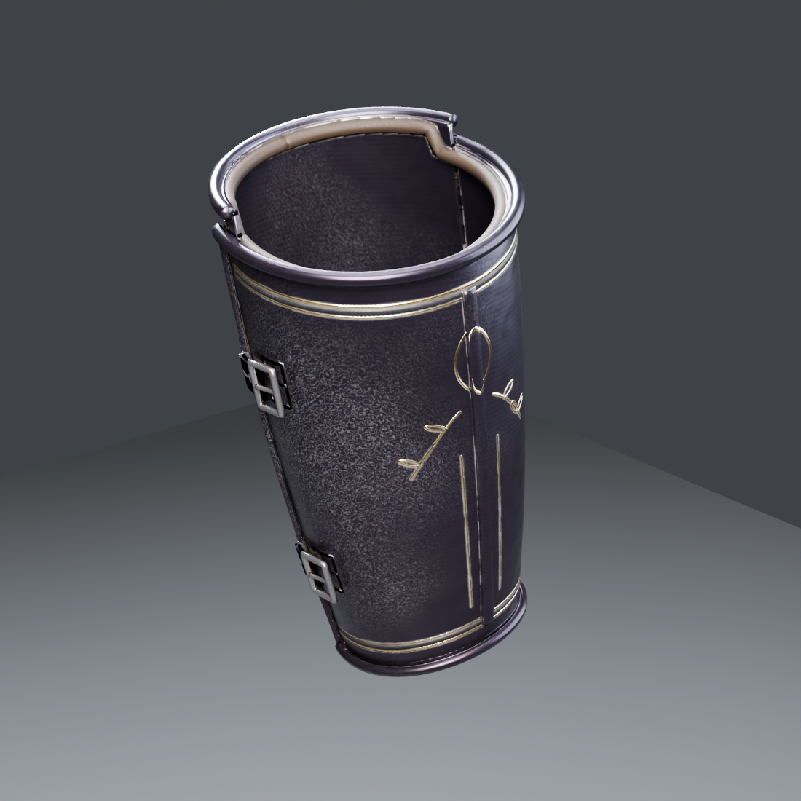

# Obsidian Sovereign: Forearms L/R (vambraces) — TGA (Claude), 2026-10-31

This is one of the six missing pieces of the set. It is built with **checkking's pipeline**: the procedural surfaces of revolution from `gauntletlib`, the v2 materials from the chest, and the staged high→low bake. It sits between checkking's gauntlets and the upper arms.

The bake is **2K**, the hero-armour budget from #262. The piece is **9,664 triangles per arm**. Codex's WIP version stays in `assets/Codex/Obsidian-Sovereign/Forearms` for comparison.

## Construction (same vocabulary as the greaves)

| Part | What it is |
|---|---|
| Outer shell | Plate over the back of the forearm with a **raised keel**. The bottom tucks **under the gauntlet's flared cuff**; the top is low at the elbow crease and rises to the sides. |
| Inner shell | Plate on the palm side, highest at the point of the elbow (under the couter). The outer shell overlaps it on both sides. |
| Edges | **Rolled edges** top and bottom, side rims on the outer shell, and a **leather lining roll** at the top. |
| Hinges | 2 hinge barrels with leaves and rivets on the outer side (+X for the left arm). |
| Straps | 2 leather straps with **steel buckles on the inner side**, riveted to the inner shell. |
| Ornament | Double gold borders with etched bands under the top and above the bottom, **gold lozenge + laurel sprays under the elbow**, and fine gold lines either side of the keel. |

## Files

- **Game meshes:** `SM_ObsidianSovereign_Forearms_L.fbx` and `_R.fbx`.
  - Metres, Z up, facing −Y, **in the Codex set's frame**.
  - The forearm axis runs from the gauntlet's wrist centre (0.351, 0, 0.800) to the elbow (0.298, 0, 1.105). Bottom ≈ 0.86 m under the cuff, top ≈ 1.05–1.07 m.
  - R mirrors L, with shared UVs and textures. Static, not skinned.
- **`textures/`:** 2K `T_ObsidianSovereign_Forearms_BaseColor` (sRGB), `_ORM` (R = AO, G = roughness, B = metallic), `_Normal_DirectX` (16-bit).
- **`import_forearms_ue.py`:** UE 5.3 import of both meshes and the 3 textures, plus `MI_ObsidianSovereign_Forearms` on the shared `M_ObsidianSovereign` master (made here if missing).
  - Destination: `/Game/CastleDefender/Characters/Hero/Armor/ObsidianSovereign/Forearms`.
- **`renders/`:** baked game mesh in Cycles (front 3/4, side, back 3/4, inner side).
- **`source/`:**
  - `build_forearms.py`, `bake_staged.py` + `run_bake.ps1` (paths from the work folder; Blender 5.2 OK), `render_piece.py`.
  - `clay_fit.py` renders the build next to the gauntlet and upper arm to check the fit.
  - It needs `chestlib.py` and `materials.py` from `assets/checkking/Obsidian-Sovereign/Chest/source`.

## Still open

- **Fit and skinning** to `ShadowknightUE_SK`, like the rest of the set (`lowerarm_l/_r`, KnightSlot `arms` in `handoffs/obsidian-set-v2/pieces.csv`).
- **pbr_check:** it flags the dark obsidian steel exactly as it does checkking's chest, shins and gauntlets (non-metal < 30 sRGB, metal < 150). That is the set's look by design; it is listed for the owner's ruling in #262.
