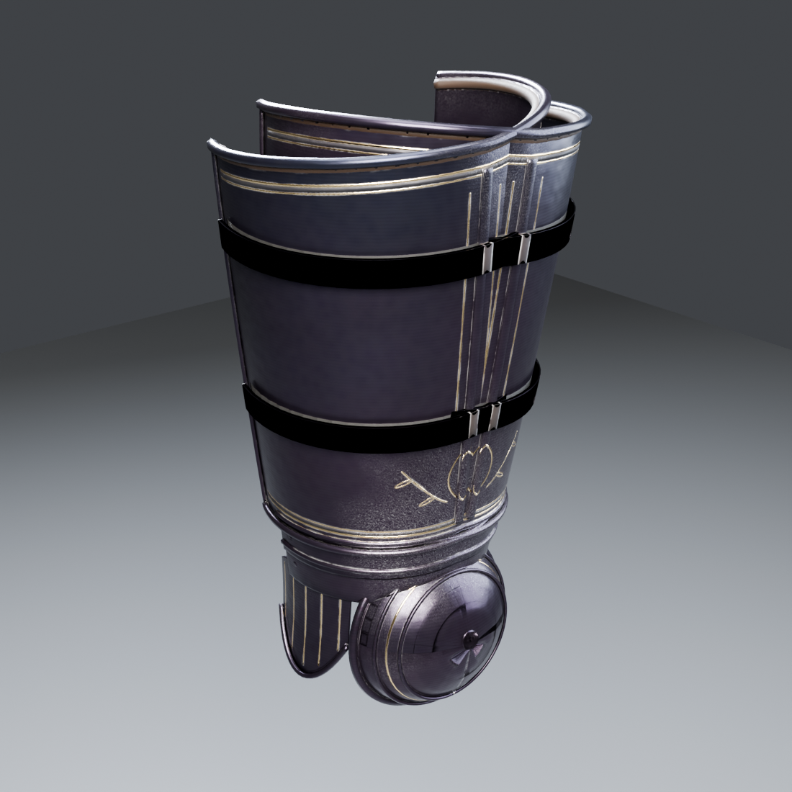

# Obsidian Sovereign: Thighs L/R (cuisses + poleyns) — TGA (Claude), 2026-10-31

This is the next missing piece of the set, built with **checkking's pipeline** (gauntletlib surfaces of revolution, the chest's v2 materials, staged high→low bake). It covers the knee cop that the greaves' README left to "the thighs piece".

The bake is **2K** (hero-armour budget, #262). The piece is **13,628 triangles per leg**. Codex's WIP version stays in `assets/Codex/Obsidian-Sovereign/Thighs`.

## Construction

| Part | What it is |
|---|---|
| Poleyn | **Domed knee cop** on its own forward axis, a boss at the tip, two raised rings and a gold ring line, sitting on top of checkking's greave. |
| Fan wing | Shell-shaped side plate on the outer side (+X), with fine gold ribs. |
| Lames | 2 articulation lames between the cop and the cuisse, riveted at the sides. |
| Cuisse | Front and side plate with a **raised keel**. The top flares a little higher on the outer hip, under the fauld / tassets. It is open at the back. |
| Edges | **Rolled edges** top and bottom, side rims, and a **leather lining roll** at the top. |
| Straps | 2 leather straps round the open back of the thigh, **steel buckles on the outer side**, riveted on the inner edge. |
| Ornament | Double gold borders with etched bands, **gold lozenge + laurel sprays over the knee**, and fine gold lines either side of the keel. |

## Files

- **Game meshes:** `SM_ObsidianSovereign_Thighs_L.fbx` and `_R.fbx`.
  - Metres, Z up, facing −Y, **in the Codex set's frame**.
  - The thigh axis runs from the knee (0.135, 0.022, 0.548), over the greave top, to the hip (0.116, 0, 0.905). The top is at ≈ 0.88–0.90 m, under the waist piece.
  - R mirrors L, with shared UVs. Static, not skinned.
- **`textures/`:** 2K `T_ObsidianSovereign_Thighs_BaseColor` (sRGB), `_ORM`, `_Normal_DirectX` (16-bit).
- **`import_thighs_ue.py`:** UE 5.3 import plus `MI_ObsidianSovereign_Thighs` on the shared `M_ObsidianSovereign` master.
  - Destination: `/Game/CastleDefender/Characters/Hero/Armor/ObsidianSovereign/Thighs`.
- **`renders/`:** baked game mesh (front 3/4, side, back 3/4, inner).
- **`source/`:** `build_thighs.py` plus the shared bake / render scripts (see the Forearms README).

## Still open

- **Fit and skinning** to `ShadowknightUE_SK` (`thigh_l/_r`, KnightSlot `pants`).
- **Straps:** the leather straps bake dark, the same as on the greaves and boots. Check them in engine.
- **pbr_check:** it flags the dark obsidian steel exactly as on the rest of the set. This is by design and is up to the owner (#262).
