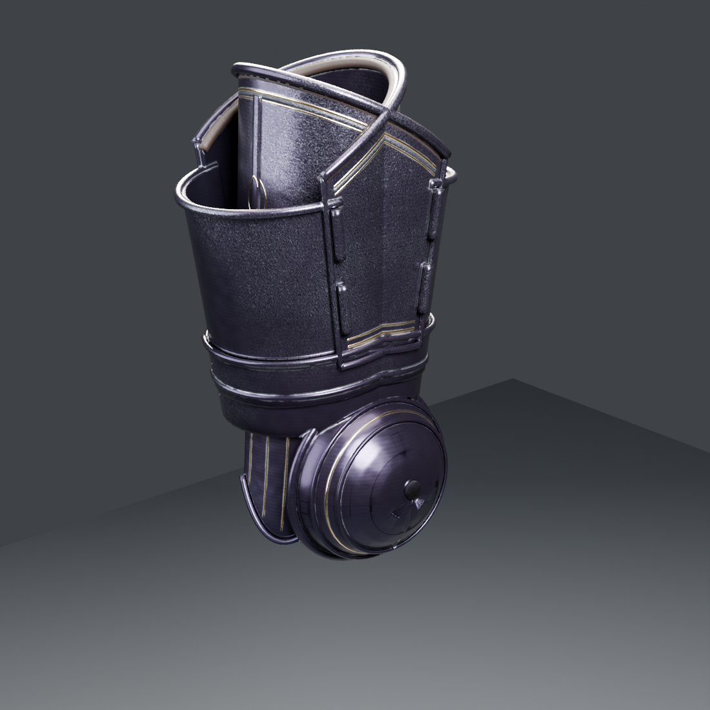

# Obsidian Sovereign: UpperArms L/R (rerebraces + couters) — TGA (Claude), 2026-10-31

This is a missing piece of the set, built with **checkking's pipeline**. The bake is **2K** (hero-armour budget, #262). The piece is **14,352 triangles per arm**. Codex's WIP version stays in `assets/Codex/Obsidian-Sovereign/UpperArms`.

## Construction

| Part | What it is |
|---|---|
| Couter | **Domed elbow cop** at the point of the elbow (its own backward axis), a boss at the tip, two raised rings and a gold ring line. |
| Fan wing | Shell-shaped wing on the outer side, with gold ribs. |
| Lames | 2 articulation lames above the couter round the back and outer side, riveted. |
| Rerebrace | Outer shell centred on the outside of the arm, with a keel, over an inner shell. **Hinges at the back overlap** and a **strap + buckle at the front overlap**. Rolled rims, a leather lining roll, gold borders + etch, and a lozenge and laurel on the outer shell. |

The top of the rerebrace sits **under checkking's pauldron**, which laps over it on the outer side, so only the lower half, the lames and the couter show in game. The bottom meets the **TGA vambrace** at the elbow.

## Files

- **Game meshes:** `SM_ObsidianSovereign_UpperArms_L.fbx` and `_R.fbx`.
  - Metres, Z up, facing −Y, **in the Codex set's frame**. The axis runs from the elbow (0.298, 0, 1.105) to the shoulder (0.268, 0, 1.36).
  - R mirrors L. Static, not skinned.
- **`textures/`:** 2K BaseColor / ORM / Normal_DirectX.
- **`import_upperarms_ue.py`:** UE 5.3 import plus `MI_ObsidianSovereign_UpperArms` on `M_ObsidianSovereign`.
  - Destination: `/Game/CastleDefender/Characters/Hero/Armor/ObsidianSovereign/UpperArms`.
- **`renders/`** and **`source/`** (`build_upperarms.py`).

## Still open

- **Fit and skinning** to `ShadowknightUE_SK`. The couter and its lames weight to `lowerarm`/`upperarm` across the elbow.
- **Couter boss:** there is a small bake artifact on the boss (a stray triangle in the normal map). It's invisible at game distance.
- **pbr_check:** it flags the dark obsidian steel as on the rest of the set (owner, #262).
