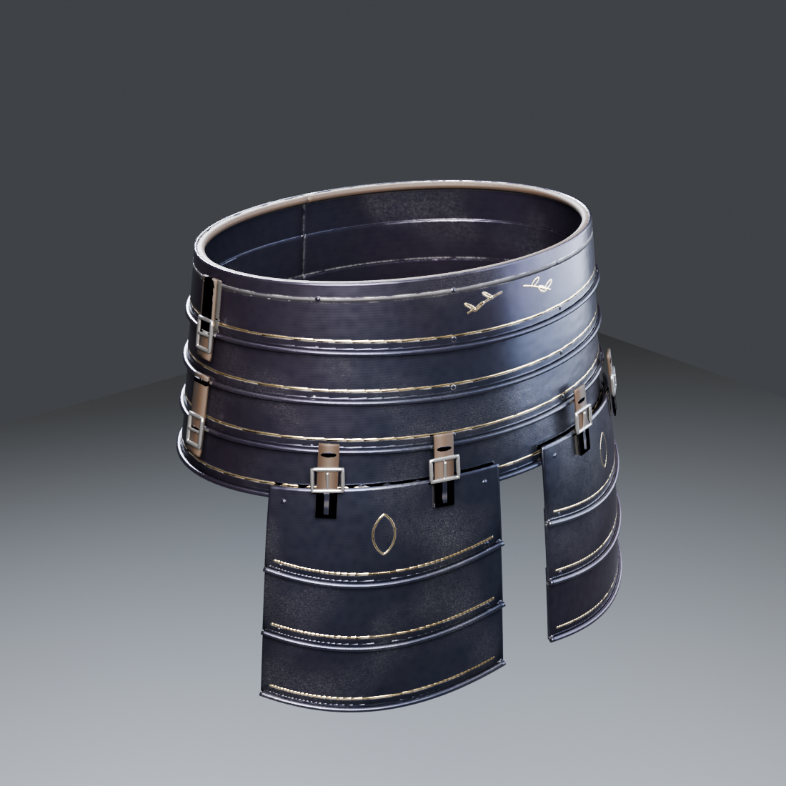

# Obsidian Sovereign: Waist (fauld + tassets) — TGA (Claude), 2026-10-31

This is a missing piece of the set, built with **checkking's pipeline**. It is **one centred piece**, not L/R.

The bake is **2K** (hero-armour budget, #262). The piece is **17,884 triangles**. Codex's WIP version stays in `assets/Codex/Obsidian-Sovereign/Waist`.

## Construction

| Part | What it is |
|---|---|
| Fauld | **4 hoop lames** round the hips, each lapping over the one below. The top lame tucks **under the cuirass's bottom edge** (checkking chest, z 0.964). Each lower edge dips a little at the front centre. |
| Edges and rivets | Rolled lower edge and a gold line on every lame, **sliding rivets** round each lame, an etched band on the top lame, a **leather lining roll** under the cuirass, and gold laurel sprays at the front. |
| Closure | Hinges on the body's left (+X) and **strap + buckle** on the right (−X), across the lames. |
| Tassets | 2 tassets of **3 lames each** over the front of each thigh, with cusped lower edges, a gold line per lame and a **gold lozenge** on the top lame. Each hangs from the lowest fauld lame on **two leather straps with buckles**. |

## Files

- **Game mesh:** `SM_ObsidianSovereign_Waist.fbx`.
  - Metres, Z up, facing −Y, **in the Codex set's frame**, centred on x = 0.
  - Top ≈ 0.985 m (under the cuirass), fauld bottom ≈ 0.83 m, tassets down to ≈ 0.70 m over the TGA cuisses.
  - Static, not skinned.
- **`textures/`:** 2K `T_ObsidianSovereign_Waist_BaseColor`, `_ORM`, `_Normal_DirectX`.
- **`import_waist_ue.py`:** UE 5.3 import plus `MI_ObsidianSovereign_Waist` on the shared `M_ObsidianSovereign` master.
  - Destination: `/Game/CastleDefender/Characters/Hero/Armor/ObsidianSovereign/Waist`.
- **`renders/`** and **`source/`** (`build_waist.py`; the bake script has a single-piece mode with no mirror).

## Still open

- **Fit and skinning** to `ShadowknightUE_SK` (`pelvis`, KnightSlot `pants`).
- **Tassets** are rigid in this static mesh. When skinned, weight each tasset to its thigh (`thigh_l/_r`) so the tassets follow the legs.
- **pbr_check:** it flags the dark obsidian steel as on the rest of the set (by design, up to the owner, #262).
