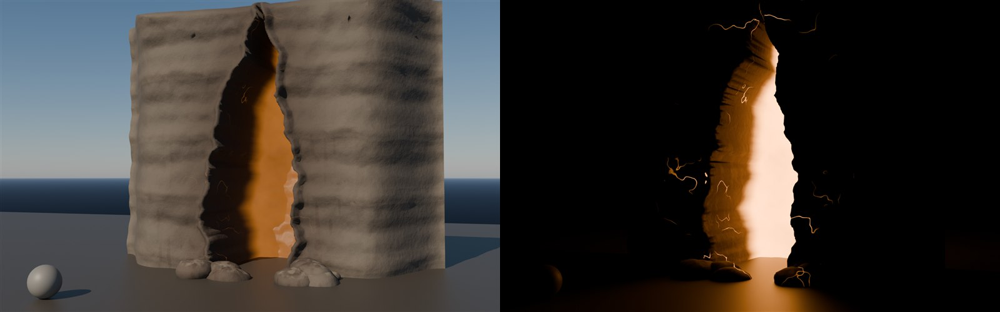

# Realm mountain crack (#169 stage 3)

Made 2026-10-30 by `TGA (Claude)`. It's the glowing fissure in the mountain north of the tentacle realm. After the
breach, the wasp swarm (#156) pours out of it. It follows the owner's sketch: an orange crack, "out of the mountain".
**Original procedural work, all in this repo.**

## What's here

| File | What |
|---|---|
| `SM_RealmCrack.fbx` | Static mesh, about 26k tris. A 14 × 11 m basalt face with a jagged fissure about 3 m wide that runs 4 m deep into the mountain, plus rubble at its foot. The edges curl back so they bury into the slope. The pivot is at the bottom centre of the opening, and it faces +Y in UE |
| `textures/T_RealmCrack_BC / _ORM / _N` | 4K. BaseColor is sRGB. ORM: AO, roughness, metallic 0. Normal is DirectX |
| `textures/T_RealmCrack_E` | 4K emissive mask: hotter with depth, plus a few thin hot veins in the lips |
| `place_realmcrack_ue.py` | Import + material + placement (below) |
| `source/` | `build_crack.py` (mesh, UVs, data bakes, numpy textures, FBX), `lookdev_crack.py` (day/night lookdev) |

## Look (knowledge-base checks)

- **Basalt:** grey-brown with strata. Lichen grows on the ledges and ash dust settles on the up-facing surfaces.
- **Around the fissure:** dark mineral streaks run **down** from it, and the rock round the mouth is heat-scorched.
- **Inside:** the fissure walls are glassy and heat-fused.
- **Restraint:** the veins are few and thin, close to the lips only.
- **Values:** `pbr_check` OK (BaseColor p5/p50/p95 49/64/86 sRGB, roughness 0.60-0.90, metal 0).
- **Texel density:** 190 px/m. That's low for a close prop but right for a mountain set piece seen from
  60 m and more.
- **Lookdev:**
  - day: grey ball metered to 118 sRGB, then locked
  - night: moonlight sky at +4.5 EV, `GlowStrength` 14, so the glow lights the ground without blowing out

## Unreal (Master)

Run `py "<repo>/assets/tga/RealmCrack/place_realmcrack_ue.py"`, then save the level.

1. **Import:** `SM_RealmCrack` and its textures go into `/Game/CastleDefender/Realm/MountainCrack`. `M_RealmCrack`
   has these parameters:
   - `GlowColor` (1, 0.32, 0.05)
   - `GlowStrength` 14
   - `PulseSpeed` 0.35, a slow 0.8-1.0 breathing of the glow
2. **Placement:** the actors go into Outliner `Gameplay/Realm`. The script is idempotent: it deletes its own actors
   first.
   - `Realm_MountainCrack`: line traces find the highest ground in a band north of the owner's realm box. The script
     walks back down toward the realm and stops on the slope about 45 % of the way up. The crack faces the realm and
     is sunk 3 m into the slope.
   - `Realm_CrackLight`: an orange point light in the mouth (60k lm, radius 35 m, shadows). Lumen needs a real light
     behind every small emissive.
   - `Realm_SwarmSpawn`: a TargetPoint 6 m out of the crack and 5 m up. **Stage-3 swarm logic spawns the wasps
     here.** The wasps circle once, then go for the cannons, then the castle.
3. **If it lands in the wrong place** (wrong peak, or no landscape collision there), set
   `CRACK_AT = unreal.Vector(x, y, z)` at the top of the script and re-run.

**Done:** from the owner's camera (-7945, 454, 1932), an orange fissure glows on the mountain behind the realm. It's
visible at day and night, and a TargetPoint sits in its mouth.
