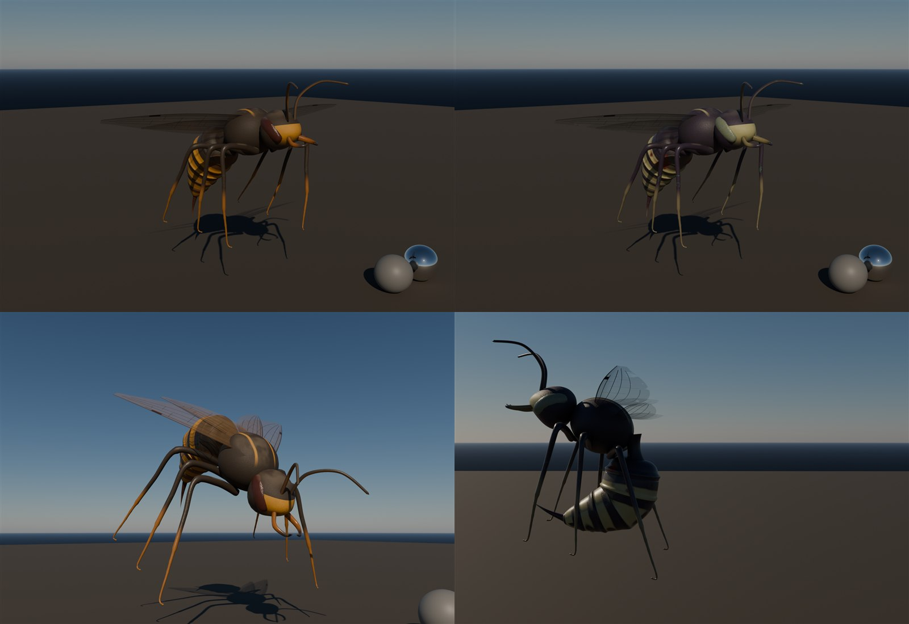
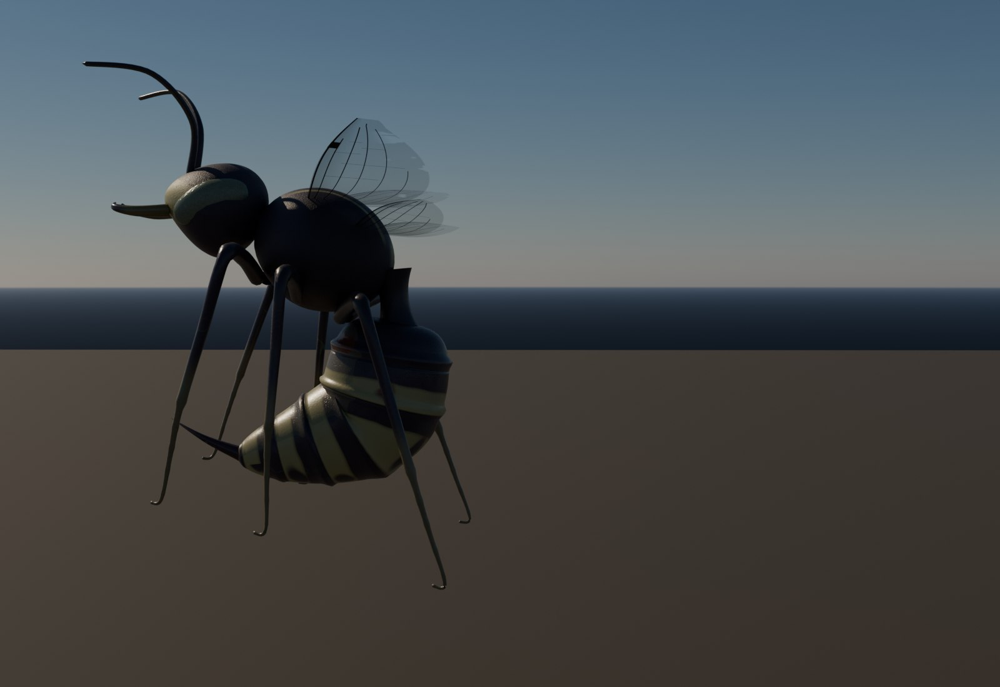
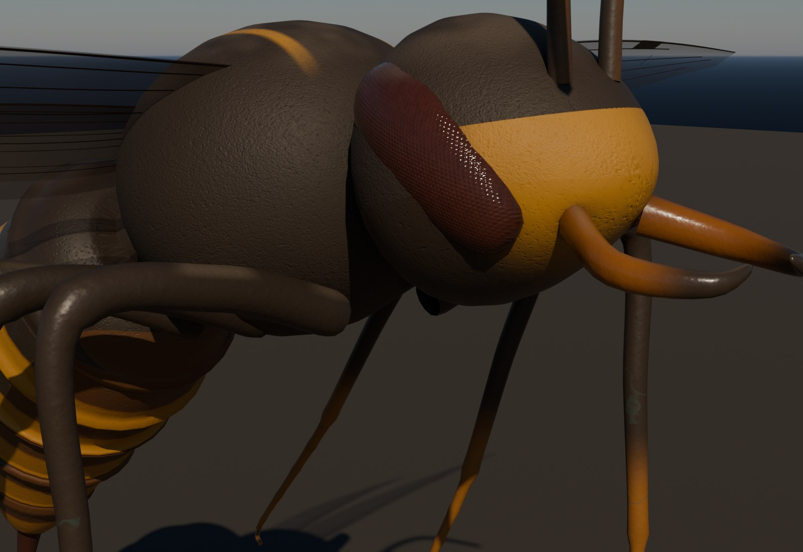

# Realm wasp: giant stinging insect for the tentacle realm (#156)

Made 2026-10-30 by `TGA (Claude)`. It's a human-sized hornet, about 1.9 m from the mandibles to the stinger, with a
2.3 m wingspan. It hovers, dives and stings, and the swarm waves join the zombie waves after the first realm breach.
**Original procedural work with no third-party assets, so everything is in this repo.**

## What's here

| File | What |
|---|---|
| `SK_RealmWasp.fbx` | Skeletal mesh + 5 animations. Body 22.4k tris, wings 1.6k tris, 32 bones, 2 material slots (`M_RealmWasp_Body`, `M_RealmWasp_Wings`). Metres, Z up, faces +Y in UE like the mannequin |
| `textures/T_RealmWasp_Body_<Skin>_BC / _ORM` | 4K. BaseColor is sRGB. ORM: R = AO, G = roughness, B = metallic 0 |
| `textures/T_RealmWasp_Body_N` | 4K normal, DirectX. It's shared by both skins |
| `textures/T_RealmWasp_Wings_<Skin>_BCA` | 2K RGBA. A = membrane opacity (0.3-0.5), veins 1 |
| `import_realmwasp_ue.py` | Editor import: textures, mesh, anims, materials, MIs |
| `source/` | The Blender scripts that rebuild everything (below) |

## Skins

- **Ember:** the realm's native hornet.
  - Dark umber chitin with amber bands, an amber face plate and dorsal thorax marks.
  - Dark femurs with amber lower legs, red-brown compound eyes.
  - A faint teal vein net (realm corruption) on the dark chitin.
- **Blight:** a sick, corrupted variant.
  - Purple-black chitin with pale bone-olive bands and milky green eyes.
  - Stronger green corruption veins, weeping red lesions on the bands.
  - Wetter, and torn wing membranes.

Both are calibrated to the knowledge-base standard (`handoffs/knowledge`):
- non-metal albedo 30-240 sRGB, metallic 0
- roughness varied at three scales (cuticle grain, mid, mottling)
- wear by cause: abraded segment rims, cavity grime, matte pile on the thorax and crown, one shared up-facing dust pass
- no lighting in the BaseColor

`pbr_check` results:

| Skin | BaseColor p5/p50/p95 | Roughness p5/p95 | Result |
|---|---|---|---|
| Ember | 44 / 51 / 126 sRGB | 0.22 / 0.74 | OK |
| Blight | 49 / 58 / 154 sRGB | 0.17 / 0.60 | OK |

Texel density is 2,757 px/m (above the 2,048 px/m hero baseline) and even on every part. UVs come from the loft
topology in metres, packed at one uniform scale. Lookdev is calibrated: the grey ball is locked at 118 sRGB.

## Animations (30 fps, root on the ground under the body; the body hovers 1.3 m up)

| Clip | Frames | Use |
|---|---|---|
| `A_RealmWasp_Hover` | 32, loop | idle in the air: 7.5 Hz wingbeat, body bob, dangling legs, antennae twitch |
| `A_RealmWasp_Fly` | 32, loop | forward flight: nose down 18°, legs trailing |
| `A_RealmWasp_Dive` | 24, loop | attack dive: nose down 50°, wings swept, legs reaching, stinger forward |
| `A_RealmWasp_Sting` | 24, one-shot | the abdomen curls under and stabs; the hit frame is **13**. Root moves 28 cm forward (lunge) |
| `A_RealmWasp_Death` | 40, one-shot | the wings stop and fold, the legs curl, it rolls belly-up and drops 1.05 m to the ground |

## Unreal (Master)

1. Run `py "<repo>/assets/tga/RealmWasp/import_realmwasp_ue.py"`. It creates
   `/Game/CastleDefender/Characters/Enemies/RealmWasp/`:
   - `SK_RealmWasp` (+ skeleton, physics asset) and the 5 `A_RealmWasp_*` anims
   - `M_RealmWasp_Body`, which has the zombie skin master's parameters (`Tint`, `TintAmount`, `Wetness`, `HitT`)
   - `M_RealmWasp_Wings`: two-sided, masked with dithered opacity. Its `WingBlur` 0..1 fades the membrane while it beats
   - `MI_RealmWasp_Body_Ember/_Blight` and `MI_RealmWasp_Wings_Ember/_Blight`

   Ember is assigned by default.
2. **Gameplay (#156)** is a suggestion; the owner can tune it.
   - Make `BP_RealmWasp` from `BP_Zombie`. Mesh yaw -90 like the mannequin, capsule radius 45, half height 60.
   - CharacterMovement: Flying mode, max fly speed 700, hover height 1.3-2.5 m with a slow sine.
   - AnimBP: blend `Hover` and `Fly` by speed; `Dive` while it closes in from above.
   - Sting: play `Sting` as a montage and apply damage on frame 13 (notify). Use 30 % #73 infection chance.
   - Death: play `Death` with no ragdoll.
   - Pick a random skin on spawn: Ember 70 %, Blight 30 %.
   - HP is about 80 (fragile but fast), and it ignores walls.
   - Some wasps lay a `BP_JellyMine` where they land (#154 tie-in).
   - Waves: in `BP_ZombieWaveManager`, when the realm gate sets `SwarmUnlocked`, every second wave adds 4-8 wasps that
     fly over the walls.

**Done:** in Play, after the first realm breach, swarm waves of wasps hover in, dive and sting; skins vary per spawn;
they die belly-up.

## Source (`source/`, Blender 5.2)

Copy to a short path (under 260 characters) and run, in order:
1. `blender -b --factory-startup -P build_wasp.py`: mesh (lofted parts, UVs from topology), wings, rig, skin weights.
2. `blender -b wasp_rig.blend -P anim_wasp.py`: the 5 clips and `out/SK_RealmWasp.fbx`.
3. `blender -b wasp_rig.blend -P bake_wasp.py`: Cycles bakes the data (position, normal, part, AO), then numpy makes
   both skins, the normal map (from a height field) and the wings. Takes about 20 min at 4K.
4. `blender -b wasp_anim.blend -P lookdev_wasp.py`: calibrated lookdev (`SKIN`, `VIEW`, `POSE`, `FRAME`).
