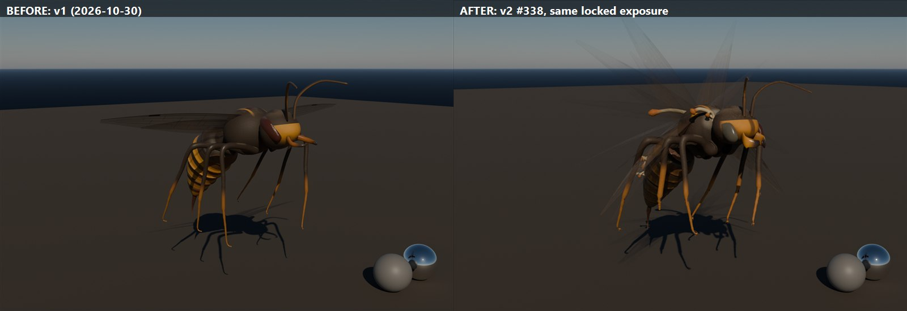

# Realm wasp v2: the zombie hornet rebuilt to the film creature method (#338)

Made 2026-11-06 by `TGA PC (Claude)` on the owner's order: "Stranger Things series quality, not a game asset", and the
wasps must actually be seen flying in Play. It follows `handoffs/knowledge/research_notes/creature_studio_method.md`
(the ILM / Weta / Framestore / DNEG / ASC / Stranger Things method, with a 10-step checklist).
**Original procedural work with no third-party assets. Binaries came to the Master by Taildrop. This folder holds the
script and sources.**

(The renders, FBX, textures and `source/` scripts are in the Taildrop zip `RealmWasp338_assets_1106.zip` sent to i9. The
two JPGs are also on the chat box: `/files/120116_wasp338_before_after.jpg` and `/files/120117_wasp338_sheet.jpg`. The Master
commits the binaries here.)

## What changed from v1, and why

| v1 problem (owner: "very basic and ugly") | v2 |
|---|---|
| Failed the silhouette test: a tube waist, a stubby gaster, smooth tube legs | True hornet anatomy in true order: emarginate (kidney) eyes, 3 ocelli, toothed blade mandibles, elbowed 13-segment antennae, pronotum collar, mesoscutum, scutellum, propodeum, a thin petiole, **6 nested gaster shells**, a sting with its sheath. Legs = coxa, trochanter, femur, tibia + 2 spurs, 5 tarsomeres, 2 claws |
| A smooth thorax (the number-one "CG insect" tell) | **5,200 real setae strands** (pile laid back toward the tail) on the head, thorax and upper legs, with a rubbed bald patch on the scutum |
| "Zombie" only as a tint | **Rot by biology**: the soft parts fail first. The gaster gapes at joint 3/4 over **wet wrinkled tissue**, a hole is broken through tergite 4, **Ophiocordyceps-style fungal clumps** grow from the neck, propodeum and gaster joints (with faint spore glow), mycelium felt around their feet, necrotic crust next to the tissue, ooze tongues running down. The right side is worse (asymmetry with a cause): collapsed milky eye, broken antenna, missing tarsus, chipped mandible |
| Wings almost invisible in Play | v1's material was masked at clip 0.33, but the membrane alpha was 0.3-0.5, so the thin membrane was clipped away and mostly only the veins rendered. v2 wings are **translucent** (membrane 0.4-0.6, wrinkled, dirt blotches, tears, ragged trailing edge), plus **wing blur cards**: 5 strobe copies over the stroke arc with a smeared texture and a shimmer, which carry the wingbeat at any frame rate |
| A dark body on a dark sky | Brighter amber warning bands, a lit wing edge, a spore-glow signature (`SporeGlow`) |
| Motion keyed as plain sines | **Driver + followers**: the wingbeat drives the body bob. The gaster, legs, antennae and sting are damped springs, simulated over 3 loops with the last one kept (seamless overlap). Staccato head snaps and holds in the hover. The sting has anticipation, a 3-frame strike, a hold on the hit, and a slow recovery |
| Death sinks under the ground | v1 dropped the body 1.05 m while the BP also turns gravity back on. Once the capsule lands, the body was about 45 cm underground. v2 drops 0.40 m, so it rests on the ground |

## Files

| File | What |
|---|---|
| `SK_RealmWasp.fbx` | Skeletal mesh + 5 clips. One mesh, 4 material slots in this order: **0 `M_RealmWasp_Body`, 1 `M_RealmWasp_Wings`** (the order the BP's SetMaterial needs), 2 `M_RealmWasp_Hair`, 3 `M_RealmWasp_WingBlur`. **34 bones** = v1's 32 names plus `wingblur_L/R`. Metres, Z up, faces +Y in UE |
| `textures/T_RealmWasp_Body_<Skin>_BC / _ORM` | 4K. ORM: R = AO, G = roughness, B = metallic 0 |
| `textures/T_RealmWasp_Body_N` | 4K DirectX normal, shared by both skins |
| `textures/T_RealmWasp_Body_SSE` | 4K masks: R = subsurface (thin chitin, tissue, fungus), G = spore glow, B = wet |
| `textures/T_RealmWasp_Wings_<Skin>_BCA` / `T_RealmWasp_WingBlur_<Skin>_BCA` | 2K RGBA (A = opacity) |
| `import_realmwasp338_ue.py` | Modes: dry run / `--apply` / `--swap` / `--unswap` / `--revert` (below) |
| `source/` | `build_wasp338.py` (mesh, hair, wings, blur cards, rig), `bake_wasp338.py` (textures), `anim_wasp338.py` (clips + FBX), `lookdev_wasp338.py`, `clay338.py` |
| `renders/` | Locked-exposure lookdev: both skins, close-up, game distance, the animation poses, and before / after |

Clips at 30 fps, with the same names as v1:

| Clip | Frames | Use |
|---|---|---|
| `A_RealmWasp_Hover` | 48, loop | 7.5 Hz wingbeat, bob, drift, gaster overlap, dangling legs, staccato head snaps |
| `A_RealmWasp_Fly` | 32, loop | Nose down 18 degrees, legs trailing, antennae swept back, bank drift |
| `A_RealmWasp_Dive` | 24, loop | Nose down 50 degrees, wings swept, legs reaching, sting cocked, jaws open |
| `A_RealmWasp_Sting` | 30, one-shot | **Hit frame 13** (the BP waits 0.43 s). Anticipation 0-9, strike 10-13, hold, recover |
| `A_RealmWasp_Death` | 45, one-shot | The wings stop, two death spasms, the legs curl, it rolls belly-up and drops 0.40 m |

## Unreal (Master)

1. `py "<repo>/assets/tga/RealmWasp338/import_realmwasp338_ue.py"`: a **dry run**. Expect `DRY RUN OK`. It checks the
   files, the BP and the 10 v1 assets the BP references.
2. `... --apply`: imports **only into `RealmWasp/V2/`**. The game still uses v1. Check the printed `material slots`
   line: it must say OK.
3. **After @Alien OKs the renders:** run `... --swap`. It backs up the 10 v1 assets the BP uses into `RealmWasp/V1_Backup/`,
   then consolidates each one into its v2 twin. BP_RealmWasp then loads v2 with no graph edit.
   - Undo the swap with `--unswap`.
   - `--revert` deletes the V2 folder (unswap first).
4. Play with the swarm test switch (adjustedfilm's part of #338). In the Output Log, there must be no "Accessed None" from
   BP_RealmWasp.

**Untested here: this PC has no Unreal editor.**
- The script is syntax-checked only, so the dry run is its first test.
- Material nodes worth a glance after apply:
  - Subsurface shading on the body (`SubsurfaceAmount` 0.6)
  - translucent wings with `TLM_SURFACE`
  - the blur shimmer (Time × 40)
- No LODs are generated. At 67k triangles in total, add the engine's auto LODs (LOD1 50 %, LOD2 25 %) if 6 or more wasps
  cost too much.
