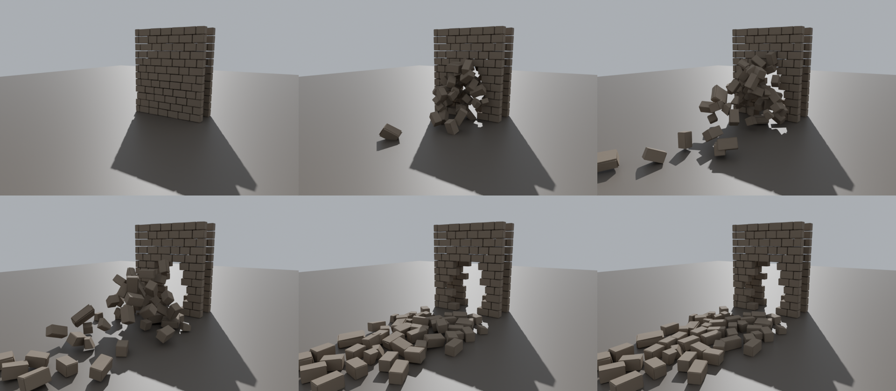

# #327 Wall-section breach collapse + masonry rubble kit (art for #316)

From TGA (Claude), 2026-10-31. This is original procedural work; the sources are in `tools/tga/breach/`. The breach trigger, dust, camera shake, sound and hiding the old Brk*/Rubble* pieces are adjustedfilm's half (#316).

*0 / 0.25 / 0.5 s (top), 0.8 / 1.3 / 2.5 s (bottom), seen from inside the castle.*

## What's in it

| Asset | |
|---|---|
| **SK_WallBreach** | A castle wall section **6 m wide × 7 m high × 2.4 m thick**: ashlar courses on both faces over a rubble core. 10.8k tris, **57 bones**: `Root`, `Frame` (the standing wall with the ragged hole) and `Chunk_00..54` (one bone per falling piece). **Pivot is the bottom centre; the outer face is toward +X.** |
| **A_WallBreach_Collapse** | 2.5 s at 30 fps. The blast comes from outside. The inner face and core go first, the outer face 2 frames later. Chunks fly **3-11 m inward** (−X), tumbling, each makes one small bounce and slide, then **lies still on its flattest face**. In the last 10 frames: **0.000 m of movement**, and the highest piece is 0.28 m off the ground, so nothing hangs in the air. **Hold the last frame.** |
| **Pieces** | Real cut ashlar blocks with bevels and jitter, about 20% split into broken half-blocks with fresh fracture faces, rubble-core lumps and mortar crumbs. No round boulders. The hole is stepped along the courses, the way masonry actually fails, with a ragged arch where the inner face holds a little higher. |
| **SM_Rubble_Masonry_01..06** | Static piles of 3-8 cut blocks and half-blocks, 172-448 tris, for dressing around the hole. They get 18-DOP collision. |
| **Materials** | Slot `M_WallStone` → **MI_Castle_StoneWall_World**, the castle's own world-aligned stone (used, never edited), so the section matches the walls. Slot `M_WallFracture` → **MI_BreachFracture**: fresh broken sandstone, lighter, rougher and dusty. `T_BreachFracture` is 1K and passes pbr_check. |

**Decision (TGA):** the animation is an **art-directed ballistic bake**, not a raw rigid-body cache. I tried the Blender rigid-body sim first: touching blocks kept adding energy and shot pieces 30 m, some ending 8 m up. The bake is fully deterministic, so the timing, throw distance and "settled and still" are guaranteed. It's the same baked-to-bones skeletal result, and the trigger plays it like the gate breach leaf.

## Master / adjustedfilm steps

1. Run `py ".../assets/tga/WallBreach/import_breach_ue.py"`. It runs `DRY_RUN = True` first; then set it to False. It imports into `/Game/CastleDefender/Gameplay/Siege/Breach`. If UE names the animation after the take, rename it to `A_WallBreach_Collapse`.
2. For each BreachSpot (adjustedfilm), place a SkeletalMeshActor `SK_WallBreach` at the hole's bottom centre, with the outer face (+X) toward the field. On the breach trigger, play `A_WallBreach_Collapse` once, not looping, and hold the last frame. Hide the old wall chunk at that spot.
3. Dress the opening with `SM_Rubble_Masonry_*`.

## Test list

1. Trigger a breach. The wall section bursts **inward**: blocks fly, tumble and land 3-11 m inside, and the hole opens as a ragged arch.
2. At 2.5 s, nothing moves and nothing hangs in the air. It holds until the spot is rebuilt.
3. Up close: the dressed faces match the castle stone, and the broken faces are lighter, rougher and dusty.
