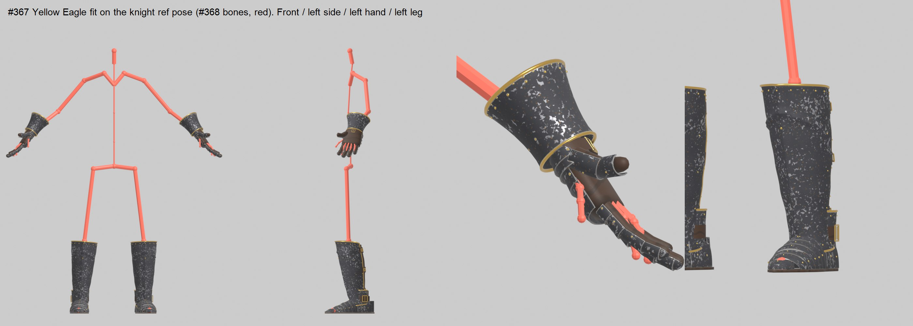

# Yellow Eagle Knight set (#367): fitted to the knight (#368)

By TGA (Claude), 2026-11-01. The gauntlets, greaves and sabatons are now placed on the hero knight's reference pose, from the
bone dump i5 ran on UE 5.8 (`handoffs/exports/master/knight_refpose.txt`, ShadowknightUE_Skeleton, 69 bones).

**Status: fitted and ready to import for a look. Not in the game yet.** The swap into the set system waits on the owner.

`renders/fit_check.jpg`: the pieces on a stick figure of the knight's bones (red). Front, left side, left hand, left leg.

## What's here
- `<Piece>/fbx_knight/SM_Eagle<Piece>_L/_R(.fbx, _LOD1-3)`: **knight-space** meshes: the knight's mesh component space at the
  ref pose (Blender: metres, Z up, facing -Y, left = +X; UE after import: cm, facing +Y). Same convention as the Obsidian v2
  pieces, so `setup_set_v2_ue.py`'s `offset = inverse(bone component transform)` attaches them correctly.
  - The canonical-frame FBXs in `<Piece>/fbx/` stay as the rebuild source.
- `<Piece>/fit_<piece>.json`: what the fit measured and applied (origin, scale, bounds) per side.
- `pieces.csv`: the set-table rows (same columns and slot ids as `handoffs/obsidian-set-v2/pieces.csv`).
- `import_yellow_eagle_ue.py`: the UE import, **DRY_RUN by default**.

## How each piece is placed
The fit uses bone **positions** only, so it doesn't depend on the bones' arbitrary roll. Script: `tools/tga/knightset/fit_knightset.py`.

| Piece | Rides on | Placement | Scale |
|---|---|---|---|
| Gauntlets | hand_l / hand_r | wrist at the hand joint; fingers along hand → middle fingertip; thumb side toward index_01; plate fingers centred on the knight's finger joints (shift 1.2 cm) | ×1.08 (knight hand 20.6 cm wrist to tip, ours 20.2, plus 6 % ease) |
| Greaves | calf_l / calf_r | along ankle → knee; shin toward the foot's forward direction; bottom 3 cm under the ankle joint | ×1.08; top sits 1 cm under the knee joint |
| Sabatons | foot_l / foot_r | sole on the ground under the ankle; toe along foot → ball (the knight's toe-out: L 12°, R 3°) | ×1.05, height ×1.15 (taller instep over the foot bones) |

R is the L fit computed on the mirrored right-side bones, then mirrored back, so the knight's small L/R differences are kept.

## Import (Master, UE 5.8.4)
1. `py "<repo>/assets/tga/YellowEagle/import_yellow_eagle_ue.py"` as it is (DRY_RUN). It writes `import_yellow_eagle_report.txt`: 0 missing files, knight mesh found.
2. Set `DRY_RUN = False` and run it again. It creates **only new assets** under `/Game/CastleDefender/Characters/Hero/Armor/YellowEagle`:
   - its own master, `M_YellowEagle` (BaseColor × Tint, ORM, Normal), with one MI per piece;
   - per piece: 3 textures and `SM_Eagle<Piece>_L/_R` with LOD1–3.

   It touches no existing material, mesh or blueprint.
3. **Fit look against the real knight:** set `PREVIEW = True` (with `DRY_RUN = False`) and run it once more.
   - It spawns a ShadowknightUE_SK actor with the 6 pieces 20 m above the level origin, in the Outliner folder `YE_FitPreview`. The level isn't saved.
   - Screenshot the front, the side, a hand and a foot, then delete the folder.
   - Post the shots on #367. If plates clip into the knight's armour or float off it, I change the `EASE` values in `fit_knightset.py` and re-export.

## Known limits
- The pieces are rigid on one bone each, like the Obsidian set. The knight's fingers curl down a little more than the plate fingers, and the fingers won't animate with the hand.
- The fit is checked against the bones only. The knight's own armour mesh is licensed and not on this machine, which is what step 3 is for.
