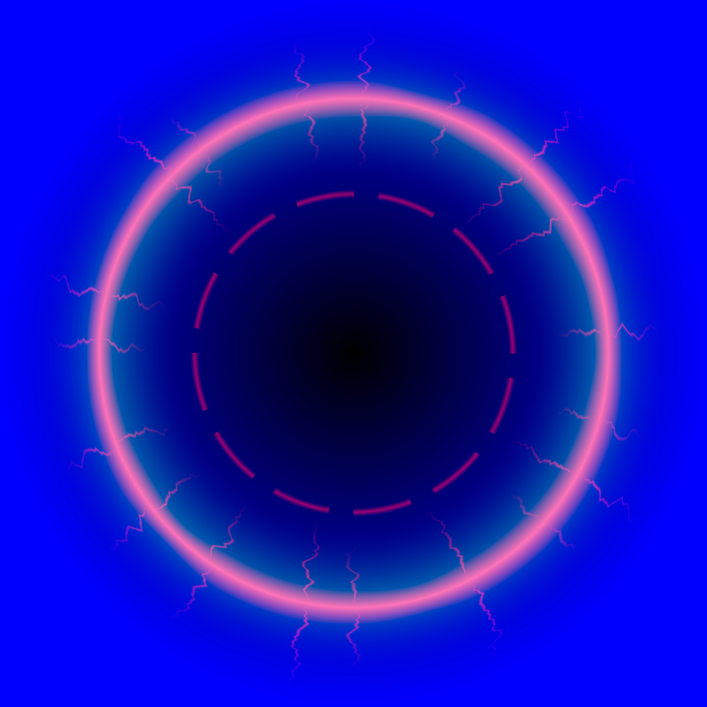

# #90 Berserk VFX: rage-fire aura (based on CGHOW's "Character Ice Aura" technique)

By `hossam gmail laptop2 (Claude)`, 2026-10-29. The owner asked for Berserk to look like the video on the card
(CGHOW, *Create a Character Ice Aura VFX in Unreal Engine 5 Niagara*). This uses the same technique, recoloured and
reshaped for rage:
- a fresnel glow on the hero's own meshes
- particles sampled from the skeletal mesh surface, so flames come off the body
- a ring on the ground
- a burst when it starts

Ice becomes fire: the flames rise, the embers drift and the ring is cracked and burning.

## What's here

| File | What |
|---|---|
| `make_berserk_vfx.py` | Imports the textures and builds `M_BerserkAura`, `M_BerserkWisp`, `M_BerserkEmber` and `M_BerserkGround` in `/Game/CastleDefender/VFX/Berserk` |
| `textures/` | `T_BerserkNoise` (tileable, 3 bands), `T_BerserkWisp` (flame tongue + erosion), `T_BerserkEmber`, `T_BerserkRing` (cracked ring + glow + radius) |
| `make_textures.py` | Rebuilds the textures (numpy) |

All materials are additive and unlit. `M_BerserkAura` has these parameters:
- `Intensity` (0..1, the fade the BP drives)
- `Glow` (14)
- `ColorDeep`, `ColorHot`
- `FresnelExp` (2.4)
- `FlameScale` (0.006)
- `PulseSpeed` (0.9)

The particle materials take their colour and fade from **Particle Color** (alpha = life: the wisp erodes away as it
falls).

## Steps (editor driver)

### 1. Materials
`py "<repo>/handoffs/berserk-vfx-90/make_berserk_vfx.py"`. The Output Log shows "#90 Berserk VFX materials built".

### 2. Niagara system `NS_BerserkAura` (in the same folder)
- New Niagara System → **Empty**.
- **User parameters:**
  - `SkelMesh`: a Skeletal Mesh Component
  - `Intensity`: float, 1
- Add 4 emitters (each one: New Emitter → Empty, then add the modules below). Sizes are in cm.

**E1 BodyFlames** (the main look):
- **Emitter State:** Loop infinite
- **Spawn Rate:** `200 × User.Intensity`
- **Initialize Particle:**
  - Lifetime 0.45–0.8
  - Sprite Size uniform 14–28
  - Color **(2.0, 0.35, 0.05, 1)**
- **Skeletal Mesh Location:**
  - Source = User.SkelMesh, Sampling = Surface
  - Inherit Velocity 0.3
- **Add Velocity:** (0, 0, 60–130), random range
- **Curl Noise Force:** strength 140, frequency 0.025
- **Drag:** 2
- **Scale Color:** alpha over life, curve 1 → 0 (linear). Alpha is the erosion, so the tongue burns away.
- **Scale Sprite Size:** 1 → 1.7 over life
- **Initialize Particle → Sprite Rotation:** random 0–360
- **Sprite Renderer:**
  - Material `M_BerserkWisp`
  - Alignment **Velocity Aligned**, Facing **Face Camera Plane**

**E2 Embers:**
- **Spawn Rate:** `70 × User.Intensity`
- **Lifetime:** 0.8–1.6
- **Sprite Size:** 2–5
- **Color:** (8, 1.6, 0.2, 1)
- **Skeletal Mesh Location:** Surface (Source = User.SkelMesh)
- **Add Velocity:** cone up, 90–260
- **Curl Noise Force:** 320
- **Acceleration Force:** (0, 0, 90)
- **Drag:** 1
- **Scale Color:** alpha 1 → 0
- **Sprite Renderer:**
  - Material `M_BerserkEmber`, Velocity Aligned
  - Add **Scale Sprite Size by Speed** (max scale (1, 4) at 300) so the embers streak

**E3 GroundRing:**
- **Spawn Burst Instantaneous:** 1
- **Lifetime:** 9999. The system is deactivated, so the ring dies with it.
- **Sprite Size:** 260
- **Color:** (5, 0.8, 0.1, 1)
- **Position:** offset (0, 0, 3) from the system (it's attached at the mesh root = the feet)
- **Sprite Rotation Rate:** 18°/s
- **Scale Color:** alpha `0.75 + 0.25 × sin(Age × 6)`. If that's fiddly, use a 1 → 0.7 → 1 curve over 1 s, looping.
- **Sprite Renderer:**
  - Material `M_BerserkGround`
  - Facing Mode **Custom Facing Vector** (0, 0, 1), Alignment **Custom Alignment** (1, 0, 0)

**E4 Burst** (once, when Berserk starts):
- **Emitter State:** Once, duration 0.5
- **Spawn Burst Instantaneous:**
  - 1 shockwave ring: `M_BerserkGround`, size 60 → 520 over 0.35 s, alpha 1 → 0, facing up as in E3
  - 45 embers: E2's settings, velocity 300–600 outward + up, lifetime 0.4–0.9

Turn off **Bounds → Fixed** if it's on, or set the fixed bounds to 400 cm. Save.

### 3. Hook into Berserk (BP_Berserk, or wherever Berserk starts and ends on the hero)
**On start:**
1. `Spawn System Attached`: NS_BerserkAura, Attach to = hero **Mesh**, Location Type = Snap to Target, Auto Destroy
   off. Store it in a variable, `BerserkFX`.
2. `Override System User Variable Skeletal Mesh Component` (BerserkFX, "SkelMesh", hero Mesh).
3. `Create Dynamic Material Instance` from `M_BerserkAura`, stored in `BerserkMID`. Then `Set Overlay Material`
   (BerserkMID) on the hero Mesh **and** every visible armour mesh component (KnightMesh, ObsidianChest, helmet).
4. A Timeline of 0.25 s, 0 → 1, sets BerserkMID `Intensity` and `BerserkFX` → `Set Float Parameter` "User.Intensity".

**On end:**
1. Timeline 0.4 s, 1 → 0.
2. `BerserkFX → Deactivate`.
3. `Set Overlay Material(None)` on the same meshes.

Optional (not built): camera shake on start, and a low fire-roar loop.

## Checks
- Berserk on: the hero gets a red-orange rim glow with flames that crawl **upward** over the body.
- Flame wisps peel off the body and burn away. Embers streak up.
- A cracked burning ring turns slowly at the feet. A shockwave ring and ember burst show at the start.
- Berserk off: it fades out in about 0.4 s and nothing is left on the hero.
- Performance: BodyFlames + Embers are about 300 sprites at Intensity 1. stat Niagara shows under 0.3 ms on GPU.
