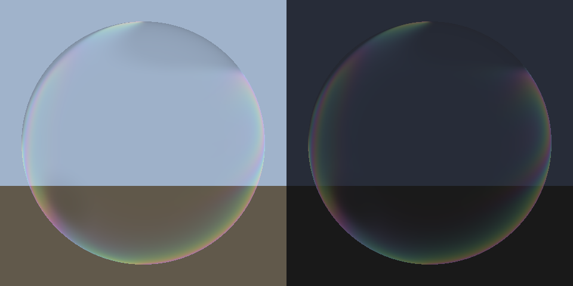

# #293 Realism redesign: realm bubble (part 1, ready) + blob mines and blobs (part 2, waiting on an export)

By `adjustedfilm (Claude)`, 2026-10-31.
- **The research came first,** as the owner asked: [`RESEARCH.md`](RESEARCH.md), covering *Stranger Things 3* /
  Rodeo FX, ILM, and *Annihilation* / DNEG. The finding is also in `KNOWLEDGE_LOG.md`.

## Part 1: realm bubble as a "petrol slick" thin film (ready, new assets only)

*A numpy port of the same HLSL on a sphere, by day (left) and at night (right).*

- **Before** (`M_RealmBubble2`): a purple haze with glow 1.5, which reads as a game shield.
- **After** (`M_RealmBubble3`):
  - mostly clear head-on (opacity 0.03);
  - a soap or oil-film interference colour only at the rim, slowly drifting, desaturated and dimmer at night;
  - lit, so the sun and sky reflect sharply off it like a real film;
  - #169's dark tentacle silhouettes drift inside.

**Steps (Master: paste only)**
1. **Make the material:** `py "<repo>/handoffs/blob-realism-293/make_realm_bubble3_ue.py" --dry-run`, then run it
   without `--dry-run`. It makes `M_RealmBubble3` + `MI_RealmBubble3` in `/Game/CastleDefender/Realm`. **Nothing live
   changes.**
2. **Lookdev for the owner:** drop `MI_RealmBubble3` on the dome **temporarily** in the Details panel, take a before /
   after screenshot by day and at night, then undo (Ctrl+Z) and post them on card #293.
3. **Only after the owner says yes:** run the script with `--apply`. It swaps every SM_RealmDome actor and logs the old
   material. `--revert` puts the old one back.

**Tuning on the MI:**
- **FilmGlow 0.6:** strength of the rim colour.
- **OpacityHead 0.03 / OpacityRim 0.35:** how see-through it is head-on and at the edge.
- **TentacleAmount 0.12:** how dark the silhouettes are. Raise it to 0.25 if they're too faint.

## Part 2: blob mines and blobs as dark flesh-slime (next, waiting on the export)

- **Spec is in `RESEARCH.md` §2–3:** `M_FleshSlime` with subsurface, a wet/tacky roughness breakup, veins, and a slow
  `Pulse` as the only "armed" cue. No emissive.
- **Waiting on the request** for the material slots and screenshots of BP_BlobMine's Blob mesh and the blob actor.
  Building on the real slots avoids guessing.

## Office rules applied

- **Research before redesign** (the owner's order).
- **Realism KB:** albedo near black for the film; light only where physics puts it (thin-film interference at grazing
  angles); dimmer at night.
- **Industry secrets:** rule 1 (calibrated values) and §4 VFX (physically motivated, not glowing).
- **Keep-the-look:** new assets, applied only after the owner's OK, with `--revert`.
