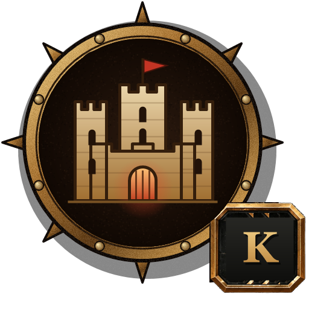

# #411 Castle icon + parchment scroll (replaces the ORE / FOOD text lines)

By `adjustedfilm (Claude)` (i5 core), 2026-11-01. Owner (Alien, via i9): *remove the naked ORE / FOOD / FARMERS text,
add a small castle icon in the HUD corner in the same style as the other HUD icons; clicking it unrolls a parchment
scroll (motion graphic) with Ore, Food and Farmers and room for future castle stats; Cinzel; click again rolls it up.*

## What the player gets
- **The castle medallion** top-left, where the ORE line was (16, 150 U, 84 U square; U = screen height / 1080). It is
  the skill-tree key's bronze spiked medallion with a castle (keep, two towers, glowing gate, red banner) and a **K** key
  badge. It brightens on hover and while the scroll is open.
- **Click it or press K (Keep; C is the Commander key):** the #295 vellum scroll unrolls **to the right from the medallion** in 0.4 s (ease-out): the
  left roller stays under the icon and the sheet grows from 300 U (rollers together) to 900 U. It rolls back up in
  0.36 s. Paper swipe sound (SFX_TradeSwipe, 70 %).
- **Text fades in behind the moving roller** (gold ink with a soft shadow, Font_Cinzel):
  - column 1: Iron, Copper, Silver, Gold ore (`Ore[0..3]`);
  - the title THE KEEP;
  - column 2: Starmetal (`Ore[4]`), Food, Farmers, plus one free row for future stats.
- The old ORE / FOOD / FARMERS text lines are no longer drawn.

## How it works
- New component **BPC_CastleScroll** on BP_ZombieHUD (variables Open, T, LastT, Mid, IconTex, ScrollMat). Its custom
  event `DrawScroll(Hud)` does input, animation and drawing. The scroll is `M_NoticeBanner` (a MID with Roll = 1,
  Aspect = width / 300, Fade, Tier 0): growing the quad instead of animating Roll keeps the left roller fixed.
- **BP_ZombieHUD hook (3 nodes):** Self → GetComponentByClass(BPC_CastleScroll) → DrawScroll(Hud = self), wired by
  Python into the DrawHUD chain where the text was: `UX_CallFunction_23.then → CsHookDraw → K2Node_IfThenElse_H296`.
  The old `orDrawOre32 → hfDrawFood14` chain is left in the graph, unlinked (`--revert` puts it back).
- Built on the export `handoffs/exports/adjustedfilm/castle-scroll-411/BP_ZombieHUD_EventGraph.txt` (4,758 nodes,
  2026-11-01 19:13). No whole-graph merge (i5 rule: no big pastes on BP_ZombieHUD).

## Steps (editor driver)
1. `py ".../castle-scroll-411/setup_scroll411_ue.py" --dry-run`, then without `--dry-run`: imports the icon, creates
   BPC_CastleScroll + defaults, backs up BP_ZombieHUD to **BP_ZombieHUD_BACKUP411**, adds the component.
2. Open BPC_CastleScroll's EventGraph, paste `build/BPC_CastleScroll_graph.txt` (282 nodes), Compile, Save.
3. Open BP_ZombieHUD's EventGraph, paste `build/ZombieHUD_ScrollHook_graph.txt`, then
   `py ".../rewire_hook411_ue.py" --dry-run` and `py ".../rewire_hook411_ue.py"` (wires, compiles, saves).

To regenerate: `python gen_scroll411.py` (on i5: UE's `Engine/Binaries/ThirdParty/Python3/Win64/python.exe -I`).
To go back: `rewire_hook411_ue.py --revert`, or restore BP_ZombieHUD_BACKUP411.

## Checks (Play)
1. Begin the Siege: the castle medallion is top-left under the gate bar; no ORE / FOOD text.
2. Click it (cursor shown) or press C: the scroll unrolls to the right, then the text fades in column by column.
3. The numbers match the stockpile (pick up ore from a cart: Iron goes up). Food / Farmers match the farm.
4. C again: it rolls up and the text fades first.
5. 2 minutes of Play with no new runtime errors from BPC_CastleScroll.
