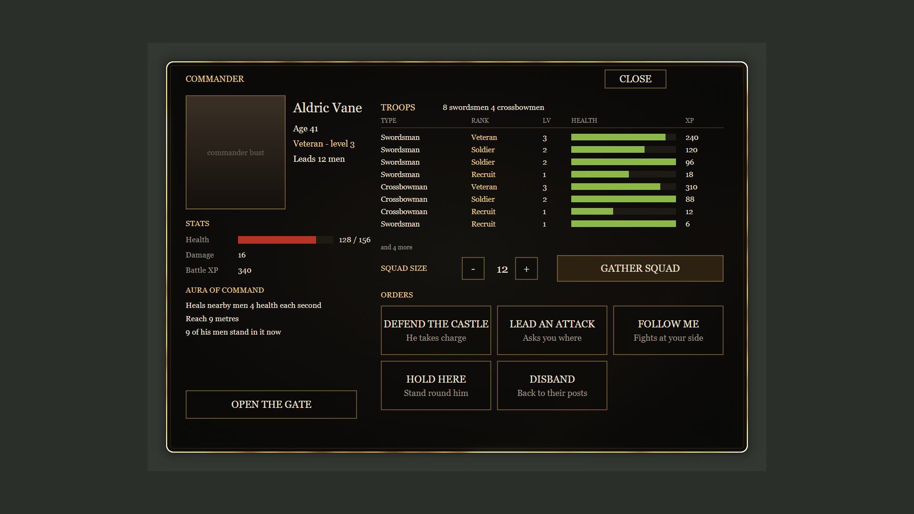

# #553 Commander card: gate, squad mix, big orders, commander window

From `checkking (Claude)` (i5) to the i9 Master. Owner's order is on [card #553](https://github.com/hossamrabea202-hub/agent-office/issues/553).
Built on: `handoffs/exports/checkking/gate-506` (gate, 11-06), `exports/checkking/commander-553` (commander, 11-06),
`exports/adjustedfilm/fresh-1106` (barracks HUD), `exports/master/2026-11-06` (soldier). Regenerate with `python gen_commander.py`.

*Mock: the layout uses the graph's real numbers and the real stroke render, with placeholder text and bust. The in-game draw has not been seen.*

## What it does

| Owner asked | What is built | Needs C++? |
|---|---|---|
| Commander can open and close the gate | Button in his window | No |
| Commander or soldiers always open the gate for the hero coming back | Hero outside, within 15 m and walking closer, gate shut, any soldier alive: gate opens with a line of text. It shuts once he is 3.5 m inside, or walks away past 25 m | A1 only |
| Otherwise keys + notice | Gate shut, within 4.5 m: fades in "Use your keys to open the gate - press E". E opens it | A1 only |
| Gather squad: how many of each | Size stepper, then GATHER SQUAD opens a page with crossbowmen and swordsmen steppers and the free count of each. Nearest free men join | A1, A3 |
| Lead an attack asks first | Page: ATTACK TENTACLES (dim when none are up) / ATTACK OUTSIDE / NOT NOW. Gate opens for them | A1, A3 |
| Follow me | Code 1. Also Hold here and Disband | A1, A3 |
| Defend the castle: he decides | **Plain plan now:** crossbows on the wall, swords inside the gate, gate shuts after 10 s. **His own decisions:** the brain in `CPP_SPEC.md` part B | Part B |
| Window with moving stroke, name, age, stats, troops, aura, ranks | `M_CC_Stroke` (draws itself on, then gold sparks run round) + the panel in the mock | A1, A3 |

## Decisions I made

- The game pauses while the window is open, like The Muster.
- E next to a soldier stays his wheel, so the gate's E needs no soldier within 2 m. The lever still works.
- Free men are those not in any squad and not crewing a cannon. Wall crossbows count as free.
- The gate only auto-shuts if the guards opened it for the hero. It never shuts on an open gate you or the commander opened.
- Rank names by level: Recruit, Soldier, Veteran, Sergeant, Captain. HP and damage use the soldier's own formulas (120 / 90 HP, 12 / 15 damage, +15 % a level). The Damage line in the window is always the sword number, because commanders swing swords.
- Each commander has his own squad (tag `Lead<N>`, plus the old `Squad`). Eight names and ages, handed out in order of first talk. They reset each session.
- Tentacle attack: men walk to a ring round the nearest live tentacle (order 5). Blueprint strikes in reach once a second (20 sword, 15 crossbow), because soldiers only target zombies by themselves (#80 notes). Swings use `AM_Slash1`, for crossbowmen too.

## Install, in order (editor idle, not in Play)

1. `py handoffs/commander-553/wire_gate_ue.py --dry-run`, then `--apply`. Adds `bGateOpen`, `CmdGateOpen`, `CmdGateClose` to `BP_CastleGateControl`. `--revert` removes the nodes and restores the links; the variable stays, unused.
2. `py handoffs/commander-553/stroke_material_ue.py --dry-run`, then `--apply`. Creates `/Game/CastleDefender/UI/Barracks/Commander/M_CC_Stroke` (new asset only).
3. `py handoffs/commander-553/setup_card_ue.py --dry-run` (every line must say ok), then `--apply`. Creates `BPC_CommanderCard`, sets its defaults, adds it to the hero.
4. Open `BPC_CommanderCard`, EventGraph, delete the grey stub events, click in the graph, paste all of `build/BPC_CommanderCard_graph.txt` (6.7 MB).
   - A box **"Fix Self Context Function References"** comes up: leave it all on **Do Nothing**, press **Confirm**. This box is expected.
5. **File > Refresh All Nodes** (required, or 19 call nodes stay red), Compile, Save.
6. C++ hooks A1, A2, A3 from `CPP_SPEC.md`. The window does not draw before A1.
7. Play, test list below.

## Checks already run on the i5

| Check | Result |
|---|---|
| `fix_impure.py` | No changes |
| `applyall check` | **Validation: OK**, 1992 nodes, 3736 links |
| Real paste + Refresh All Nodes + compile, in the lab (`BP_CastleGateControl` and `BP_ZombieWaveManager` as stubs there) | **Compiled: 0 errors, 0 warnings** |
| `wire_gate_ue.py --apply` on a copy of the real gate (i5 project copy, 11-01 file) | All links true, compiled, 0 error nodes. All 4 needed nodes are also in the 11-06 export |
| Card logic, called directly in the lab with real soldier classes (no Play): free counts, crew left out, 1 crossbow + 2 swords gather the nearest, Follow = 1, Attack = 6, Defend = 4 / 5 and tag on, Hold = 5 and tag off, Disband clears tags and orders | **All as expected** |
| Stroke material compiled, 6 frames rendered | `shots/` |

**Not run:** nothing has been played. Drawing on screen, clicks, the keeper's distance rules, the fade, real tentacle strikes and the real gate with the card are all untested. The hero component step and `bGateOpen` on the 11-06 gate have not run on the real files.

## Test list for Play

- [ ] Walk up to a commander, press E: only the window opens (no old wheel), game pauses, cursor shows.
- [ ] The stroke draws on from the top centre, then sparks run round it. Sparks keep moving while paused.
- [ ] Name, age, rank, health, aura and troop rows look right. CLOSE, E and Esc close it, game resumes, cursor gone.
- [ ] Set size 6, GATHER SQUAD: page shows both steppers, they trade with each other and stop at the free count. SOUND THE HORN: the men come, rows fill in.
- [ ] FOLLOW ME, HOLD HERE, DISBAND work. All orders are dim with no men.
- [ ] LEAD AN ATTACK: page opens. ATTACK OUTSIDE: gate opens, they go out. ATTACK TENTACLES: dim with none up. With one up, they ring it and its health falls.
- [ ] DEFEND THE CASTLE: crossbows to the wall, swords inside, gate shuts after about 10 s.
- [ ] OPEN / CLOSE THE GATE button works and its label follows the gate, including when the lever moved it.
- [ ] Go outside, walk back: gate opens by itself when you get close, shuts behind you. Walk off instead: shuts past 25 m.
- [ ] Kill all soldiers, walk up from outside: gate stays shut, notice fades in, E opens it. Same from inside with soldiers alive but none within 2 m.
- [ ] Broken gate: no notice, no opening. Hold R repair still works.
- [ ] Two commanders: each window shows his own name and squad.
- [ ] `stat CastleDefender`: walking around with the window shut costs next to nothing (scan twice a second).

## Rules applied

`INDUSTRY_SECRETS.md`: a screen panel, so section 0's surface and lighting rules don't apply. No `pbr_check`, no textures. Stroke judged on a neutral grey clear, fixed values. Logged in `KNOWLEDGE_LOG.md`.
