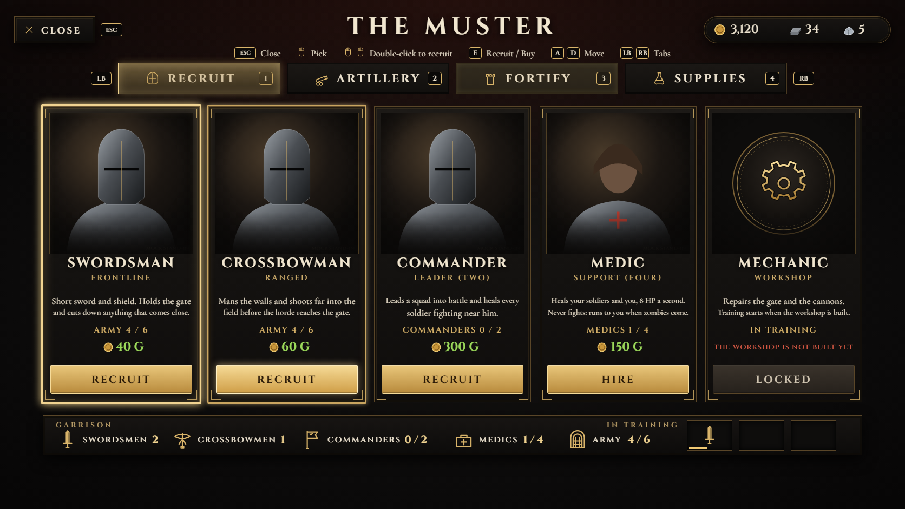

# #420 The Muster v2 (TGA): bigger click targets, one simple screen, real unit busts

The owner rejected v1 in Play (21:01–21:02): clicks barely registered, the layout had too many panels, and the soldiers
showed line glyphs instead of portraits. The button also read "E NOT NOW" because the army showed 0 / 0.

*Mock: the busts in this picture are stand-ins. In the game, each card shows a capture of the real unit Blueprint, made by
the setup script below.*

## What changed
| Owner's point | v2 |
|---|---|
| Clicks barely respond | **Two root causes fixed.** (1) v1 left the input mode at Game Only, so the viewport captured the mouse on press and swallowed clicks; v2 sets **Game And UI** (no mouse lock, cursor kept) while the screen is open and restores Game Only on close. (2) v1 read `WasInputKeyJustPressed(LMB)`; v2 makes its own press edge from `IsInputKeyDown` (`PrevDown`), so a click is caught on the frame it lands. Every hit test uses the exact rect that is drawn (same X / Y / scale at any resolution). |
| Better layout, easier menus | One screen: 4 big tabs (click, **1–4**, LB / RB, Tab) and **one row of big cards**. Each card has the portrait, name, what it does, the live count, the price, and **its own button**. The right GARRISON / CASTLE panel and the centre preview are gone; the garrison is one strip under the cards. A big **CLOSE** button sits top-left (Esc, B, Backspace work too). |
| Feedback | Hover lights the card frame, the tab and the button; pressing darkens the button; a buy flashes it; a refused buy shakes it, plays the fail sound and says why. **Click** a card to pick it, **click its button or double-click the card** to buy, or press **E**. |
| Soldier / commander icons like before | Swordsman, crossbowman, commander and medic show **rendered busts of the real units** (BP_SoldierSword / Xbow / Commander, BP_Medic), captured in the editor by the setup script. Castle items get engraved medallions. If a capture fails, that card falls back to its medallion. |
| "E NOT NOW" / army 0 / 0 | v1 read `MPC_Barracks Cnt.A` as the army cap, but BP_BarracksHUD stores a timestamp there, and only after a recruit. v2 uses the old screen's own rule (BP_BarracksHUD, 10-30b export, CX_3003…CX_3114): **army = BP_SoldierSword actors + Que.R in training, cap = 2 × hero Level + 4**, so a level-1 hero can field 6. The words are plain: the button says **ARMY FULL**, **QUEUE FULL**, **NO FREE PAD**, **NOT ENOUGH GOLD**, **OWNED**, **MAXED** or **LOCKED**, and the card says what to do ("Army full: level up to recruit more"). |

## Deep review: every number on the screen against the game data (owner 21:03)
Sources: BP_BarracksHUD (10-30b export), the unit Blueprints, BP_CannonOrder (#230), BPC_Medics (#185), BPC_CastleUpgrades
(#224) and BPC_Flares (#277).

| On screen | v1 (wrong where marked) | v2: the real source |
|---|---|---|
| ARMY n / cap | **Cnt.R+G / Cnt.A**: lifetime recruit totals over a timestamp, so 0 / 0 → FULL | all `BP_SoldierSword` actors (crossbowmen and commanders are child classes, so they count) + `Que.R` in training, over **2 × hero Level + 4** |
| Swordsmen / crossbowmen | **Cnt.R / Cnt.G**: recruits ever made, which include the dead | live actors: Sword − Xbow − Commander, and Xbow |
| Commander limit | **one**, read from `Cnt.B` (that's a kind flag, not a count) | **two per army** (owner): live `BP_SoldierCommander` + those queued (Kind 2 in RQ). At 2: MAXED, "Two commanders already lead your army". No other system blocks a second one; the only "one commander" check was the old screen's key path (CX_3287). |
| Swordsman / crossbowman price | 40 / 60 × 1.25^(Cnt.R+G) | unchanged: exactly the old screen's formula (CX_53 / CX_55 / CX_3033, both multipliers 1) |
| Commander price | 300 | unchanged (CX_3285) |
| QUEUE FULL | RQ length ≥ 3 | unchanged (BP_BarracksHUD RQ, #188) |
| Free cannon pads | actors tagged `CannonPad` | unchanged and correct: BP_CannonOrder retags a reserved pad `CannonPadUsed` |
| Medics n / max, price | BPC_Medics Count / MaxMedics / Price | unchanged |
| Walls / towers level, price, ores | BPC_CastleUpgrades Walls / Towers + the #224 cost table | unchanged |
| Flares | BPC_Flares Owned / Price | unchanged |
| Mechanic, gate bands | locked (#50) / at the forge (#208) | unchanged; shown as LOCKED with the reason |

Note: BP_CommanderHUD finds *a* commander with GetActorOfClass, so with two it shows the first one. Tell me if the second
one should get its own HUD.

Prices, ores, the training queue and every buy still go through the same systems as v1 (the Enqueue / HudBuy add-ons
already merged for #359). The v2 generator reuses v1's refresh code, so the rules haven't changed.

## Install (i5)
The v1 hooks stay as they are: the ArmoryHUD MusterSeq, the BarracksHUD gate, and the HudBuy add-ons. Event name and
inputs are unchanged.

1. Run `build/setup_muster2_ue.py` as it is (`DRY_RUN = True`) and read `build/setup_muster2.txt`.
2. If nothing says MISSING, set `DRY_RUN = False` and run it again. It does four things:
   - backs up v1 to `BPC_Muster_v1_backup`;
   - imports `T_MU2_Frame` and `T_MU2_Atlas`;
   - captures the 4 busts (`T_MU_Bust_*`); PNG previews go to `Saved/MusterBusts/`;
   - adds the v2 variables and sets every default.

   The spawned capture actors are destroyed afterwards, so don't save the level if the editor asks.
3. Open BPC_Muster, select everything in its **EventGraph** and delete it, then paste `build/BPC_Muster_graph.txt`.
   Compile and Save. The generator's `applyall check` reports **Validation: OK** (1,514 nodes).
4. Play at the barracks and check:
   - [ ] E opens; the cursor is free; a **single click** on any card selects it.
   - [ ] Clicking a card's button buys; double-clicking a card buys; E buys.
   - [ ] Hover lights each tab, card, button and CLOSE.
   - [ ] At game start the army reads **n / 6** for a level-1 hero (not 0 / 0), and recruiting works.
   - [ ] A second commander can be recruited; a third shows MAXED. The swordsmen and crossbowmen counts match the soldiers on the field.
   - [ ] With too little gold, the button shakes and the message shows.
   - [ ] Tabs work by click, by 1–4, and by LB / RB.
   - [ ] CLOSE, Esc and B all close the screen; after closing, the mouse is back in game mode.
   - [ ] Post a shot of the RECRUIT tab with the busts on #420.

**To roll back:** paste the EventGraph from `BPC_Muster_v1_backup`, and set FrameTex / AtlasTex back to T_MU_Frame /
T_MU_Atlas.

## Still open
- **The two round icons over the key hints** in the owner's shot (`barracks-hud-359/owner_210054_muster.png`) are the hero's
  ability icons at the bottom centre-left. v2 keeps that area empty: the key hints sit in the header under the title, and the
  "not enough gold" message sits above the cards. No other Blueprint needs to change.
- Bust framing uses the `head` bone/socket (or the bounds when there isn't one) and a 28° lens. If a bust is badly cut,
  post `Saved/MusterBusts/*.png` and I'll tune the camera numbers.

## Files
| File | What |
|---|---|
| `build/BPC_Muster_graph.txt` | v2 EventGraph (from `tools/tga/vesna/gen_muster2.py`) |
| `build/muster_data.json` | variables, tables and atlas UVs |
| `build/setup_muster2_ue.py` | DRY_RUN setup: backup, textures, busts, variables |
| `assets/tga/Muster/textures_v2/` | T_MU2_Frame (1920×1080) and T_MU2_Atlas (2048²), from `tools/tga/vesna/render.ps1 -Only muster2` (`layout_mu2.py` + `muster2.html`) |
| `renders/muster_v2_mock.png` | the mock above |
