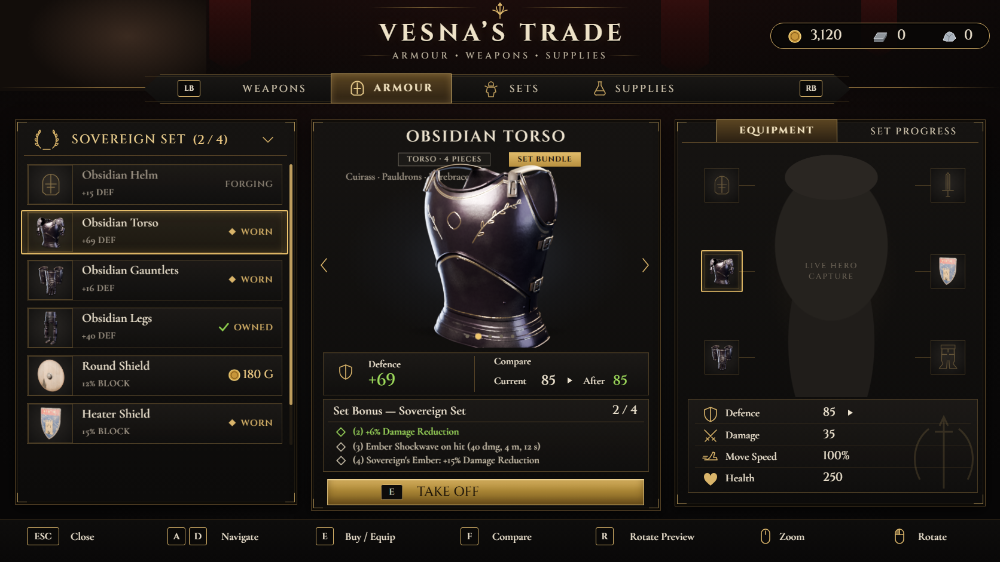
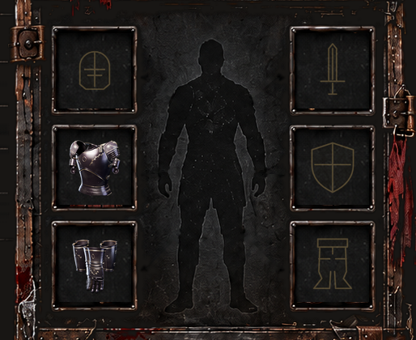

# #424 The Obsidian set as 4 bundles: Helm, Torso, Gauntlets, Legs

By the i9 helper (Claude), 2026-11-02. Owner decision: Alien. Applied by i9.
- **Graph checks:** BPC_ObsidianSet v3 has 689 nodes and passes `applyall check` (Validation: OK). BPC_VesnaTrade has 1,943 nodes and also passes (Validation: OK).
- **Zero-default scan:** no pin is left with a literal 0 where the C++ default isn't 0.
- **Not compiled yet:** that needs the editor.

## What changes in the game
- **Vesna's ARMOUR list** has 7 rows:
  - the 4 bundles:
    - Obsidian Helm (Helmet);
    - Obsidian Torso (Cuirass, Pauldrons, Rerebraces, Cape);
    - Obsidian Gauntlets (Gauntlets, Vambraces);
    - Obsidian Legs (Sabatons, Greaves, Cuisses, Fauld);
  - the 3 shields from #418, unchanged.
- **Buying a bundle** buys and wears all of its parts. E on an owned bundle takes it off or puts it back on, all parts together.
  - The price is the sum of the parts' prices. The player only pays for the parts they don't own yet, so pieces bought before #424 count.
- **Set tiers count bundles worn:**

  | Bundles worn | Effect |
  |---|---|
  | 1 | −3 % damage taken |
  | 2 | −6 % |
  | 3 | −10 % and the ember shockwave |
  | 4 of 4 | −15 %, Sovereign's Ember (the completion flash) and the faster shockwave |

  The list header and the Set Bonus box show `n / 4`. SET PROGRESS shows the 4 tiers.
- **Vesna's EQUIPMENT doll** now has the inventory's 6 slots:
  - left column: Head, Torso, Hands;
  - right column: Weapon, Shield, Boots.

  A slot shows the bundle's icon when the bundle is worn. An empty slot shows a faint gold outline (the head slot shows a helmet). The shield slot shows the worn kit shield.
- **The I-key inventory doll** looks the same way. Worn bundles show their icon in Head / Torso / Hands / Boots. Empty slots, weapon and shield included, show the faint outline.
  - This is display only: the old inventory's items, clicks and tooltips work as before.
- **New icons:** the bundle icons are composites of the real Cycles turntable renders (`textures/T_VT_Bundles_424.png`). The outlines are new engraved glyphs in the shop's atlas style (`T_VT_Atlas_424`).
  - The Helm has no art yet, so its row says FORGING and uses the helmet glyph, as before.

## Apply steps (i9 Master)
Only two light component Blueprints change. The hero, BP_ZombieHUD, BP_SkillTreeHUD, BP_BarracksHUD and BP_ArmoryHUD stay untouched, and the ArmoryHUD hook stays as it is.

1. **Dry run.** Run `py "C:\Users\hossa\Documents\agent-office\handoffs\obsidian-bundles-424\setup_bundles_ue.py"` as it is (`DRY_RUN = True`).
   - Read `setup_bundles.txt`. Every line must say `ok`, and `masks cover all 11 parts once: True` must be there.
2. **Real run.** Set `DRY_RUN = False` and run it again. It:
   - backs up `BPC_ObsidianSet_v2_backup` and `BPC_VesnaTrade_v2_backup`;
   - imports `T_VT_Atlas_424`, `T_VT_Frame_424` and `T_VT_Bundles_424`;
   - adds the variables and sets the data on both components.

   **Paste right away (steps 3 and 4):** until both pastes are in, the old graphs read the new data wrong.
3. **BPC_ObsidianSet.** Open its EventGraph: click empty graph, Ctrl+A, BackSpace, then Ctrl+V `BPC_ObsidianSet_v3_graph.txt`.
   - If the Fix Self Context dialog appears, confirm it.
   - File > Refresh All Nodes, then Compile and Save. Close the tab.
4. **BPC_VesnaTrade.** Do the same with `BPC_VesnaTrade_bd_graph.txt`, then Compile and Save. Close the tab.
   - It calls `BuyBundle` / `ToggleBundle` on BPC_ObsidianSet, so step 3 must be compiled first.
5. **Check the pastes (optional).** Re-export both graphs and run `defdiff.py` / `applyall check`. Look for no orphan pins and no `[real]` 0 that became 1.

## Play checklist
- [ ] Open Vesna > ARMOUR.
  - [ ] The list shows Helm (FORGING), Torso, Gauntlets, Legs and the 3 shields, with bundle icons and prices: Torso 690, Gauntlets 160, Legs 400.
  - [ ] Header `(0 / 4)`; the doll shows 6 outline slots.
- [ ] Buy the Torso with enough gold:
  - [ ] gold goes down by 690;
  - [ ] the row turns WORN;
  - [ ] the cuirass, pauldrons and rerebraces appear on the hero (the Cape only once its art is imported);
  - [ ] the doll's Torso slot shows the icon;
  - [ ] `(1 / 4)`.
- [ ] E on the Torso row: every Torso part goes away, the slot shows the outline again. E again puts them back.
- [ ] Buy the Gauntlets and the Legs: `3 / 4`, tier 3, and the ember aura and shockwave start.
- [ ] With 0 gold: "Not enough gold, hunter." and nothing is bought.
- [ ] Close the shop and press I.
  - [ ] Torso, Hands and Boots show the bundle icons.
  - [ ] Head is a faint helmet outline.
  - [ ] Weapon and shield show their items (or outlines when empty).
  - [ ] The inventory's own clicks still work.
- [ ] Quit Play and start again: owned and worn bundles come back.
- [ ] 2 minutes of Play with no new runtime errors from BPC_ObsidianSet or BPC_VesnaTrade (`pie_smoke.py`).
- [ ] Quick test without gold: in PIE, call `DebugGiveAll` on the hero's BPC_ObsidianSet. Every bundle that has art should be worn, and `BundleCount` should reach 3 (the Helm has no art yet).

## Roll back
- Paste the EventGraphs back from `BPC_ObsidianSet_v2_backup` and `BPC_VesnaTrade_v2_backup`.
- Put the old defaults back: re-run `obsidian-set-v2/setup_set_v2_ue.py` and `shop-v2-418/trade/setup_trade_v2_ue.py`.

## Decisions
- **Part prices:** 10 gold per DEF point, anchored on the classic rack's cuirass (450 g for +45 DEF).
  - Bundles: Helm 150, Torso 690, Gauntlets 160, Legs 400 (set 1,400).
  - The data is `PartPrice` on BPC_ObsidianSet, so tuning it needs no paste.
- **Tiers:** 1 → 0.03, 2 → 0.06, 3 → 0.10, 4 → 0.15 (`TierAt` / `TierDR` data).
- **When a bundle counts as worn:** every part of it that has art is worn. The Helm has no art yet, so the most anyone can wear today is 3 / 4. Importing the helmet mesh and re-running `setup_set_v2_ue.py` makes 4 / 4 reachable.
- **The Torso's cuirass** is still the existing MPC `Armor` item (BP_ArmoryHUD). Wearing the Torso sets Armor = (1, 1, 0); taking it off sets (0, 0, 0). Ownership stays in the set's save.
- **Inventory doll is display only.** Wearing and taking off happen at Vesna (E). This avoids fighting the old inventory's click logic on the torso cuirass.
- **The Legs bundle uses the Boots slot.** Its preview turntable is the greaves'.

## Open items for i9 (not done here)
- **Classic rack cuirass:** the WEAPONS tab still sells the cuirass on its own (BP_ArmoryHUD). After a Torso take-off the rack offers it again.
  - Hiding that rack item is a small BP_ArmoryHUD edit, left out to keep the heavy HUDs untouched.
- **Damage numbers:** the inventory's DEF number still counts only the old items (+45 cuirass). The bundles' damage reduction comes from the set tier.
- **v2 paste traps** found while building this:
  - `gen_set_v2.py` has 3 `Add_IntInt(i, 0)` indices that paste as `i + 1`: the TierAt lookup, LoadSaved's `Data[i]` (so saved owned/worn load shifted), and the DrawArmoury row loop. v3 fixes all three.
  - The live #418 Vesna graph has 4 more traps. The `_bd` graph fixes them.
  - `BPC_ObsidianSet`'s `Shield.A` MakeColor still pastes as 1 (unused).

## Files
| File | What |
|---|---|
| `setup_bundles_ue.py` | DRY_RUN setup: backups, 3 textures, variables and data (writes `setup_bundles.txt`) |
| `BPC_ObsidianSet_v3_graph.txt` | the full component EventGraph (from `gen/gen_set_v3.py`, a fork of `obsidian-set-v2/gen_set_v2.py`) |
| `BPC_VesnaTrade_bd_graph.txt`, `trade_bd_data.json` | the full Vesna component EventGraph and its row data (from `gen/gen_trade_bd.py`, a fork of `tools/tga/vesna/gen_trade.py`) |
| `textures/` | `T_VT_Atlas_424` and `T_VT_Frame_424` (rendered by `gen/render_bd.ps1` from `tools/tga/vesna/{atlas,chrome}.html?L=bd` + `layout_bd.py`); `T_VT_Bundles_424` (from `gen/make_bundle_icons.py`) |
| `renders/` | `mock_424.png` (the shop, from `live_bd.js`), `inventory_doll_424.png`, `bundle_icons_424.png`, `atlas_424_grid.png` |
