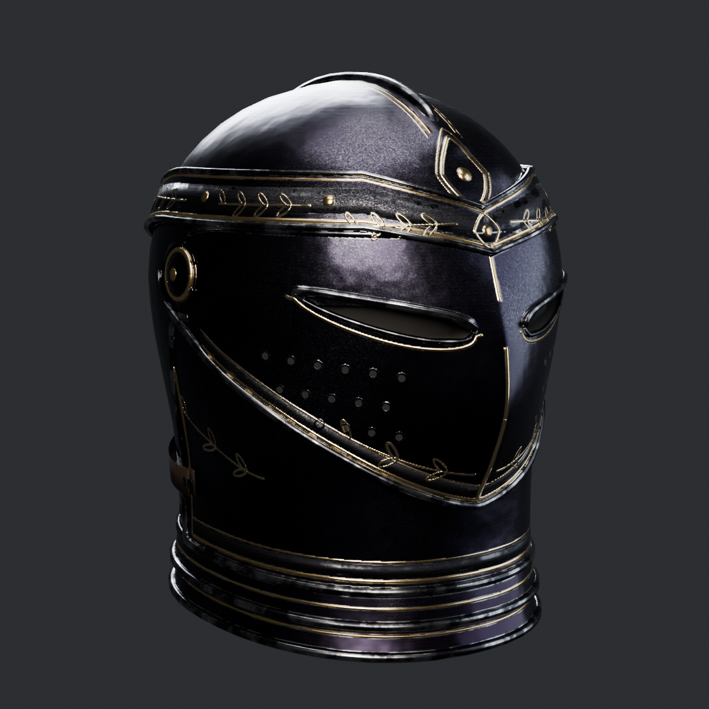

# Obsidian Sovereign helm (card #485)

An armet: a pointed visor with two raked sights and pierced breaths, a brow band with gold laurel, a medial comb, cheek plates, two neck lames, a rondel at the nape and a leather closing strap. It has no horns. It uses the set's blackened steel and gold inlay.

**State: not in the game yet.** The FBX, textures and scripts are done. The script has only been dry-run, and the helm has never been imported into Unreal or seen in Play.

## Steps for i9 (the Master applies and saves)

Do this with Play stopped. The script aborts in PIE.

1. Run the dry run: `py "<repo>/handoffs/obsidian-sovereign/helmet/setup_helmet_ue.py" --dry-run`. It needs no `STOP` lines.
   - On i5 it stops on one thing: the hero's copy of BPC_ObsidianSet is still empty. If i9 shows the same, run `faults-1205/f3_fix_ue.py --apply` first.
   - Run F3 **before** this script. F3 run afterwards sets ObsOwned and ObsWorn from AvailMask, which would make the helm free at the start.
2. Check the `EmberMinTier` line. It should say it goes to 4, because i9 has `ember2_ue.py` saved. If it prints the WARN instead, ember2 isn't on that machine.
3. Apply: `--apply`. It saves the new assets, BPC_ObsidianSet and the hero BP. It writes `helmet_backup.json` and prints a read-back line, which should show hero rows 16, last id 15, AvailMask 1023.
4. Play test on a new game, after deleting the save slot `CastleSaveObsidian`:
   - Vesna shows Obsidian Helm at 150 gold instead of FORGING. Buying it takes 150 gold and the helm appears on the hero.
   - The set shows 4/4. The ember skill, key 7 and the badge wake at 4/4, not 3/4.
   - E on the Helm row takes it off and puts it back. The knight helmet slot hides only while the helm is worn.
   - Idle, run, sword attack, crossbow aim and looking up and down: check the helm doesn't float, tilt or cut into the cuirass collar or gorget, and no skin shows in the sights or at the neck.
   - Check with the Torso bundle off too. The hidden helmet slot also holds the knight's neck mantle, so look for a gap at the collar.

To undo: `--revert` restores the data and removes Obs_Helmet. Add `--delete-assets` to remove the Helmet folder as well.

## Decisions for the Master or owner

- **Bought, not given.** By default a new game starts at 3/4 and the helm costs 150 gold, because the card asks for it to be purchasable. `f3_fix_ue.py`'s note says a new game starts in every piece that has art. If that is what the owner wants, add `--start-owned`.
- **EmberMinTier goes from 3 to 4**, as `ember2_ue.py` says to do when the helm ships. Players at 3/4 lose the key-7 skill until they buy the helm, and the automatic on-hit shock returns for them.

## Size and fit: what was measured

All numbers are UE cm in knight space. Blender y = -UE y.

| Item | Measured | How |
|---|---|---|
| Head bone | (0, -4.489, 157.109), roll 90 | editor, `AnimPoseExtensions.get_reference_pose` on the knight's skeleton. The old note in `../README.md`, (-1.9, -0.8, 153.7), does not match the ref pose |
| Hero head | x -9.8..10.2, y -15.6..8.3, z 147.2..179 | all 12,571 vertices of SM_HeroHead, through HeroHead's relative transform |
| Gorget (neck part) | x +-9.3, y -13.7..8.0, z 148.1..155.7 | all 2,716 vertices of SM_Gorget_Neck |
| Knight helmet, hornless shell | about 19.4 wide, y -17..8.9, top z 182.7 | Helmet_M vertices in the licensed FBX, horns and mantle cut by a filter, so the width is approximate |
| **This helm** | **x +-12.5, y -18.0..11.9, z 149.3..183.0** | delivered FBX. Width includes the pivots and depth includes the rondel; the shell is +-11.65 wide |

**Clearance** (`fit_report.json`, from `source/fit_check.py`, ref pose only):
- **Head:** 0 of 12,571 vertices outside the helm. The closest is 0.47 cm from a helm surface.
- **Gorget neck part:** 0 of 2,716 vertices outside the helm. The closest is 0.2 cm, near the nape.
- **Gorget spine part:** 4 vertices flagged at z 148.5, below the helm's lowest edge, so they are under the rim and not poking through a surface.

**Nothing can show through.** A closed dark liner covers the whole inside, and the sights have walls back to it. Looking through a sight shows the liner, not skin.

**Pivot:** knight origin at the feet, like every other piece. The mesh sits at head height in the FBX. On the hero the component's relative transform is identity.

**Proposed offset:** PieceOffset = inverse(head bone in knight ref pose) = **translation (0, 157.109, 4.489), roll -90, pitch 0, yaw 0, scale 1**. The same read reproduces all 15 saved rows of the class table to 0.0001 cm, and the script repeats that check on every run. Tag ObsK15, bone `head`.

**Frame check:** the Boots_L FBX in the repo reads y -27.7..10.4 in Blender and the imported asset reads -10.4..27.7 in UE, so the Y flip is confirmed. The helm is exported with the same axis settings.

## Files

- `SM_ObsidianSovereign_Helmet.fbx`: 14,196 tris, 1 material slot, 1 UV set. Other pieces run about 9.4k to 17.9k per mesh.
- `textures/`: 2K `T_ObsidianSovereign_Helmet_BaseColor`, `_Normal_DirectX` (16-bit), `_ORM`. Other pieces are 4K.
- `setup_helmet_ue.py`: `--dry-run` / `--apply` / `--revert`. It does not re-run `setup_set_v2_ue.py`, so the other rows stay as saved.
- `renders/`: front, side, 3/4, back 3/4, and `helm_fit_cutaway` + `helm_fit_ghost` over a proxy lofted from the measured head and gorget numbers.
- `source/`: `sh run_bake.sh` rebuilds everything in about 15 minutes. Local copies of the set's `chestlib.py` (tube winding fix) and `materials.py` (changes listed at its top).
- `probes/`: read-only editor and Blender measuring scripts + numbers. The licensed vertex clouds were kept out of the repo, so `fit_check.py` needs `probes/nomu_helm_probe3_ue.py` run again to re-measure.
- `pbr_check.txt`, `verify_fbx.txt`, `dry_run_i5.txt`: raw results.

## What was tested

- Build and bake from scratch; FBX re-imported in Blender for tris, bounds and UVs; renders from the baked low poly, in Blender Cycles.
- `pbr_check.py`: one flag left, 88% of metal texels are below 150 sRGB. That is the set's blackened steel: the shield scores 94.6% on the same check, plus two more flags this helm no longer has. Lifting it would stop matching the set, so I left it.
- `--dry-run` in the i5 editor: every check passes except the F3 stop above.

## What was not tested

- **`--apply` and `--revert` have never run**: the editor rules for this card forbid creating or changing assets. Only the API names and read-only checks ran. The hero-copy write and the read back are the likeliest places to need a fix.
- **Nothing in Unreal or Play:** no import, no look under the game's lighting or the calibrated lookdev scene, no animation, no Vesna or 4/4 test. The look was judged in Blender only.
- **Cuirass collar:** the fitted SK_ObsidianSovereign_Chest reaches z 153.5 and the helm's rim comes down to z 149.3, so they overlap in height. Python here can't read skinned vertices, so I don't know if they touch. Check this first in Play. If it cuts, raise `rim()` in `build_helm.py` and rebake.
- **Movement:** clearance is ref pose only. The head is rigid with the helm, but the gorget follows the neck, and 0.2 cm at the nape may not survive a head tilt.
- **Assumed attachments:** the template didn't report sockets. I assumed HeroHead on `head`, GorgetNeck on `neck_01` and GorgetSpine on `spine_03`. The resulting positions are plausible, but it is an inference.
- **Vesna's Helm row** keeps the atlas helmet glyph and has no turntable (`TurnTex[0]` is empty). It should still work as the FORGING row did, but a selected row that can be bought hasn't been seen. A real icon would be a follow-up.
- **Old saves** should keep what they saved; not tested.

## Known small flaws

- 131 zero-area UV triangles, probably the tube end caps (mostly hidden), not inspected one by one.
- 830 texels (0.02 %) covered twice and 0.09 % bake misses (2,028 black texels inside islands).
- UV use is 56.6 %, lower than the roughly 65 % the set's README reports for the shoulders.
- No LODs were made.
