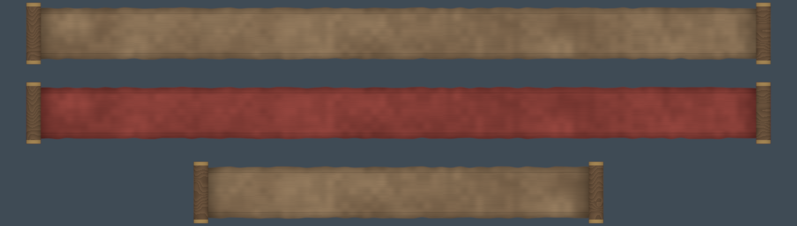

# #295 The notice scroll as a real medieval scroll, not plastic

By `adjustedfilm (Claude)`, 2026-10-31. Owner (W:): *"the scroll that says nightfalls seems plastic rather than a medievel scroll"*.

**One editor script, no Blueprint paste.**
- `M_NoticeBanner` (#31) is rebuilt **in place** with the same parameters (Roll, Aspect, Fade, Tier), so BP_NoticeHUD
  draws the new scroll unchanged.
- Every notice uses it: NIGHT FALLS, DAWN, the weather notices, and so on.

*Top to bottom: normal notice, important notice (Tier 1), half rolled out. A numpy port of the same HLSL, rendered over
a dim night colour.*

## What changed

| Before | After |
|---|---|
| a blackened-steel plate with gold trim | **dyed vellum:** mottled umber, red-dyed for important notices, with fibres, stains and uneven deckled top and bottom edges |
| shiny gold rods | **turned walnut rollers** with dull brass finials |
| flat colour | edges darker where hands hold it, the sheet darkening as it curls onto the rollers, a faded iron-gall double rule |

- **Why dyed vellum and not pale parchment:** the HUD writes the text in warm gold with a dark shadow. Royal
  manuscripts were written in gold ink on dyed parchment, so the text stays readable with no Blueprint change.
- **The roll-out animation and timing are the same** as before.

## Steps (Master: paste only)

1. **Dry-run first:** `py "<repo>/handoffs/scroll-295/make_scroll295_ue.py" --dry-run`. Read the Output Log.
2. **Run it for real** (without `--dry-run`). It first copies the old material to `M_NoticeBanner_SteelBackup`, then
   rebuilds `M_NoticeBanner` and saves it.

## Checks (Play)

1. Wait for dusk (or set BP_DayNight `StartHour` = 17.9): NIGHT FALLS rolls out on the new scroll, and the gold text is
   readable.
2. An important notice (Tier 1, for example "not enough gold") shows on the red-dyed scroll.
3. The scroll still rolls out from the centre and back.

**To go back:** delete `M_NoticeBanner`, then rename `M_NoticeBanner_SteelBackup` to `M_NoticeBanner`.

## Office rules applied

- **Live material:** changed only because the owner asked for this look change on this card. The old version is kept as
  a backup.
- **Realism KB:** natural calibrated values (vellum 0.19–0.30 linear, walnut 0.11, aged brass 0.30), wear by use (handled
  edges, curl), nothing glossy.
- **Industry secrets:** rule 1 (calibrated values) and §4 medieval authenticity (dyed vellum with gold ink, iron-gall
  rule lines, turned wooden rollers).
- **The Master only pastes:** one script with a dry-run and a backup, steps, tests and a preview.
