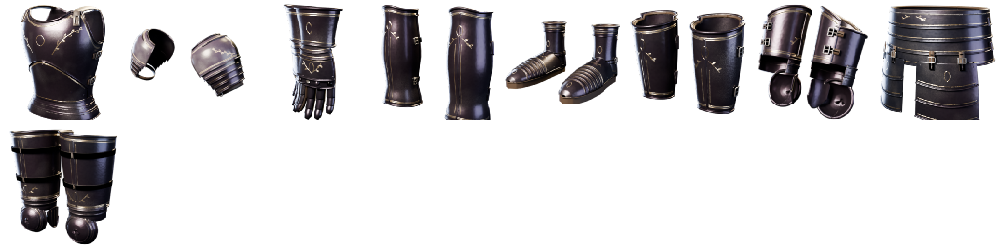

# #418 shop v2 (TGA): every armour piece and shield sellable at Vesna, wearable, with stats

## Step A: the four TGA Obsidian pieces (ready; data only, no graph paste)
Vambraces (17, forearms), Rerebraces (16, upper arms), Fauld (18, waist) and Cuisses (19, thighs) are already rows in
Vesna's ARMOUR list and already in the set table (`obsidian-set-v2/pieces.csv`, with their bones). They're hidden in the
game for one reason: their meshes aren't imported. `setup_set_v2_ue.py` leaves un-imported pieces out of `AvailMask`, and
Vesna only offers pieces in that mask. Once they're imported, the set attaches them to the hero by bone like the others,
counts them for the set tiers, and saves them.

1. Import the meshes. Each script makes its MI under `/Game/CastleDefender/Characters/Hero/Armor/ObsidianSovereign/<Folder>`:
   - `assets/tga/Obsidian-Sovereign/Forearms/import_forearms_ue.py`
   - `.../UpperArms/import_upperarms_ue.py`
   - `.../Waist/import_waist_ue.py`
   - `.../Thighs/import_thighs_ue.py`
2. Re-run `handoffs/obsidian-set-v2/setup_set_v2_ue.py`. It's safe to re-run. Its log should list rows for
   `SM_ObsidianSovereign_Forearms_L/_R`, `UpperArms_L/_R`, `Waist` and `Thighs_L/_R`, and `AvailMask` should now include
   bits 6, 7, 8 and 9.
3. Run `armour/update_trade_armour_ue.py`: first as it is (DRY_RUN), then with `DRY_RUN = False`. It imports
   `T_VT_Turn_Forearms / UpperArms / Waist / Thighs` plus the new 9-icon `T_VT_Icons`, then sets BPC_VesnaTrade's
   `IconUV`, `IconFromAtlas` and `TurnTex` from `vesna-trade-361/build/trade_data.json`.
4. Play. Vesna > ARMOUR should show the four pieces with their icons and a turning preview. Buy one and it's worn on
   the right bone. Toggle it with E.

The turntables and icons are rendered by `tools/tga/vesna/turntable.py` (now reads `assets/tga/Obsidian-Sovereign` too;
L/R pairs stand upright side by side). The textures are in `assets/tga/VesnaTrade/textures/`.

## Step B: shields (in progress)
Plan, on the card: a new hero component `BPC_ShieldKit`, shield rows at the end of the ARMOUR list showing BLOCK in place
of DEF, one `OffHand` mesh component on the hero, and one call in the hero's damage path. The Obsidian shield keeps its
own block, and only one off-hand item can be worn at a time.

It waits on fresh exports in `handoffs/exports/adjustedfilm/shop-v2/`:
- the BP_ThirdPersonCharacter EventGraph and components;
- the BPC_ObsidianSet EventGraph;
- the socket the Obsidian shield uses.
