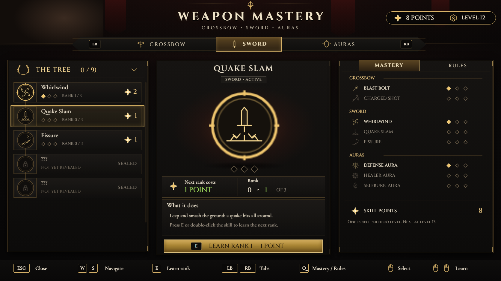

# #416 Weapon Mastery: the skill tree redesigned in the Vesna / Muster kit (TGA, 2026-11-01)

**Status: research and design done; the build waits on the live 5.8 exports** (requested on #416: BP_SkillTreeHUD,
BP_HeroAuras, BP_SkillUnlockFX EventGraphs and one 1080p screenshot). Mock-up: `renders/skilltree_mock.png`. It's rendered by
`tools/tga/vesna/render.ps1 -Only skill`, the same pipeline and textures as Vesna's Trade and the Muster.

## 1. Research: what good skill screens do
These are from the shipped games themselves (my own notes, no new sources):

| Game | What we take |
|---|---|
| God of War Ragnarök | One weapon per tab, the skill list on the left, a large animated preview and plain-language text on the right. **Our tabs: Crossbow / Sword / Auras.** |
| Diablo IV | Every node shows its rank pips (n / max) and the price of the next rank in one place, so you never hunt for the cost. |
| Hades II | Menu motion is designed, not just faded: each panel has its own reveal and the purchase gives a strong confirm. |
| Ghost of Tsushima | Locked techniques stay visible as sealed slots, so the tree promises more and the player knows where they're going. **We keep the ??? / SEALED rows**, styled. |
| Our Vesna's Trade (#361) and Muster (#359) | Same frame, tabs, list rows, centre preview, cost box, gold buy button, right summary panel and key hints. **The three screens read as one game.** |

## 2. The screen
- **Header:** WEAPON MASTERY. The purse chip shows the **free skill points** and the hero level.
- **Tabs (LB / RB, A / D, or click):** Crossbow, Sword, Auras. The auras now use **the same rows and cost badge** as the active skills, so the flat yellow UNLOCK boxes are gone (#415).
- **Left, THE TREE:**
  - one row per skill: an icon disc, the name, 3 rank pips, RANK n / 3, and the next rank's cost as a gold star with a number;
  - the cost turns red when you can't afford it, and the row says MASTERED at 3 / 3;
  - a **spine** runs through the discs and lights gold up to the last skill you've learned;
  - sealed slots are dim rings with a lock and "NOT YET REVEALED".
- **Centre, the selected skill:**
  - the title and a tag (weapon and active / passive);
  - a big engraved glyph in a lit ring on an ember halo, with 3 large rank diamonds;
  - **Next rank costs N POINTS** (green, or red if you can't afford it) and **Rank r ▸ r+1 of 3**;
  - What it does;
  - the gold button **E  LEARN RANK r+1 — N POINTS**.
- **Right panel:**
  - **MASTERY tab:** every skill's rank pips grouped by weapon, plus the free skill points and "next at level L+1".
  - **RULES tab:** the rules in one place (one point per level, rank costs, aura keys 4 / 5 / 6 at 12 s + 2 s per rank).
- **Buying (fixes #119):**
  - **E**, the gold button, or **double-clicking** a row or the big glyph learns the next rank;
  - the same checks as today's up arrow: the skill isn't sealed, its rank is under 3, and there are enough free points;
  - on success, the old `St` / `Rk*` / `Fx` writes and the BP_SkillUnlockFX book motion run unchanged;
  - on failure, the button shakes and "Not enough skill points, hunter." shows (atlas cell `nopts`).

## 3. Motion (same timings as the Muster)
- **Open:** the ember burn-in (300 ms), then the rows cascade in 40 ms apart and the centre follows at 160 ms.
- **Selection:** the gold row frame slides to the new row (120 ms ease-out), and the centre glyph cross-fades and scales from 0.92 to 1 over 180 ms.
- **Learn:**
  - the new rank diamond flashes and pops (1.0 → 1.35 → 1.0, 220 ms);
  - the spine fills up to the row (250 ms);
  - the point count ticks down;
  - the existing unlock book effect plays on top.

## 4. Game rules kept exactly (10-30 export; re-checked on the 5.8 export before the build)
- Ranks are stored in MPC_SkillTree:

  | Skill | MPC channel |
  |---|---|
  | Blast Bolt | `RkA.R` |
  | Charged Shot | `RkA.G` |
  | Whirlwind | `RkB.G` |
  | Quake Slam | `RkB.B` |
  | Fissure | `RkB.A` |

  The tree is open while `St.R` > 0.5, and the points spent are in `St.A`.
- Rank rules: max rank 3. The next rank costs rank + 1 points. Free points = Level − St.A. The upgrade branches are CX_4791 / 4803 / 4815 / 4829 / 4843.
- **To verify on the live export:**
  - the skill ↔ channel mapping above;
  - the aura costs and how auras store their ranks (BP_HeroAuras `AuraDef` / `AuraHeal` / `AuraBurn`);
  - whether the active skills have hotkeys to show. The mock leaves those out rather than guess.

## 5. Build plan (same pattern as the Muster, which is installed and compiles in 5.8.4)
- `BPC_SkillTome`: a new component that draws the screen with `T_SK_Frame` and `T_SK_Atlas` (Canvas, the same helpers as BPC_Muster) and does the input. It reads and writes **only** the existing MPC params, so saves, skills and auras keep working.
- `SkillTreeHUD_TomeGate`: a small hook that skips the old tree draw and click handling while the component is present. The old graph stays in place as the backup; removing the hook restores it.
- The aura buy calls BP_HeroAuras' existing unlock or upgrade path. Its yellow box draws (CX_557 / 568 / 579) are skipped by the same gate.
- Then I paste it in, run a Play test (open with T, learn a rank by E / button / double-click, check that you can't buy at 0 points or at max rank, and check the auras), and swap it in, as the owner asked.
