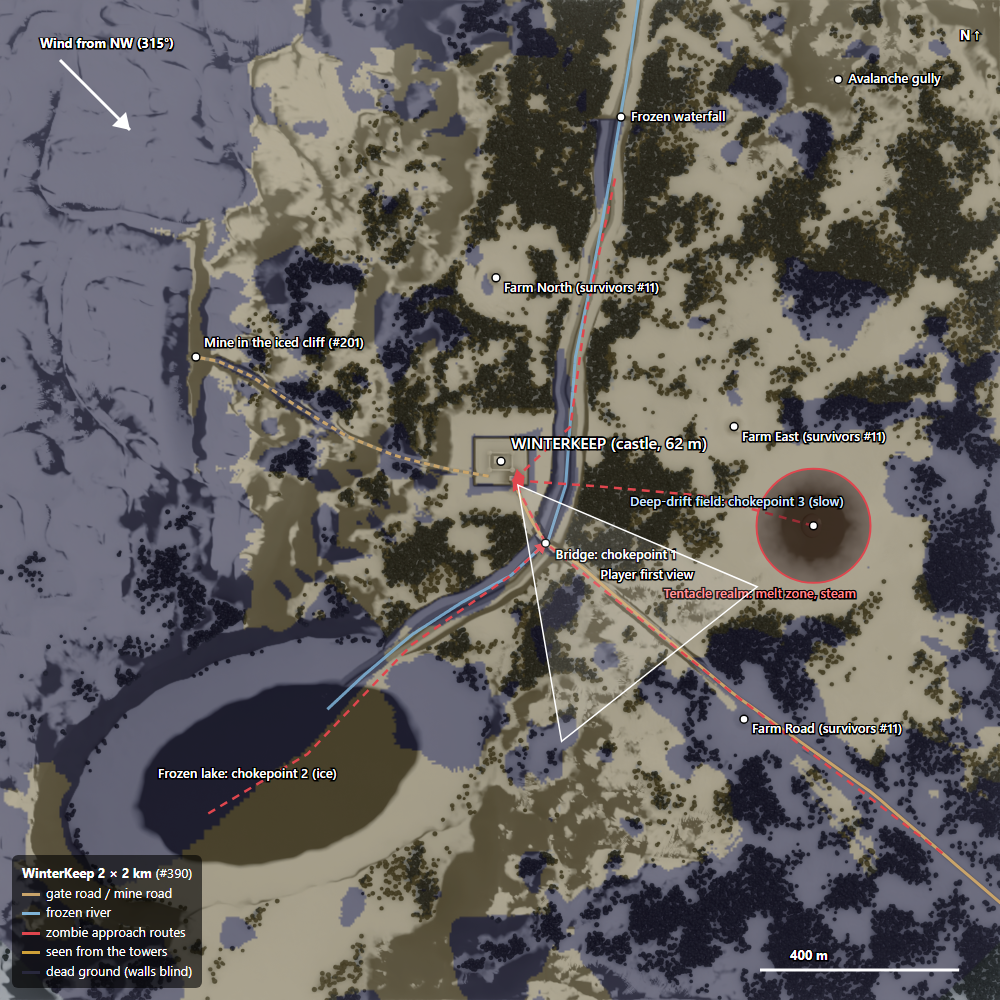

# #390 WinterKeep: design (one page)

**Level:** `/Game/CastleDefender/Maps/WinterKeep`, a new level. Nothing in ThirdPersonMap changes.
**Size:** 2016 × 2016 m, heights 4–378 m. **Mood:** a harsh high valley in deep winter. Mostly overcast, blizzard waves,
a rare low sun, and grey-blue nights.

## 1. Geology first (why the land looks like this)

- **An old glacial valley** runs NNE → SSW. The ice carved a U-shape: a flat floor and a steep **west ridge** (to 378 m)
  scoured to dark rock. The north is closed by mountains (the valley head).
- The **east** is low rolling outwash terraces, 60–100 m. That is where the farms, the realm and the open killing ground
  are.
- **The castle rise is a glacial knob** (roche moutonnée): smooth on the up-ice (NW) side and plucked steep on the lee
  (SE) side, with a long tail. The castle sits on a 96 × 84 m plateau at **62 m**, 25–35 m above the floor.
- **The river** comes out of the north head over a 14 m rock step, the **frozen waterfall**. It runs down the east side of
  the rise, cuts a short **gorge under the castle**, where the stone bridge crosses, then bends SW into the **frozen
  lake** (600 × 350 m).
- **The mine** is cut into an **iced cliff**, a 55 m rock step on the west ridge facing east.
- **The avalanche gully** is a cut down the NE slope of the valley head, with a runout fan.
- The land was eroded by about 450k hydraulic droplets plus thermal slumping at 38°, so it reads as eroded, not as noise.

## 2. Wind decides the snow

Wind comes from the **NW (315°)**. Placement uses the Winstral Sx shelter index:

| Where | What happens |
|---|---|
| Windward (NW) faces and ridge crests | scoured to rock, thin packed snow, sastrugi, **rime on the NW side** of rocks, walls and trees |
| Lee (SE) sides of the rise, walls, farms, the forest edge | **drifts up to about 3 m**, buried farmsteads |
| Flat open ground | about 0.65 m of settled snow |
| Slopes over about 45° | snow slides off, rock shows |
| Road, castle yard | thin packed snow, ruts, slush at the gate |
| Realm (radius 115 m) | **no snow**: wet black ground and steam |

## 3. Gameplay (built on the land, not painted on)

- **Chokepoint 1, the bridge:** the only dry crossing of the gorge, 150 m below the gate and in full view of the walls.
- **Chokepoint 2, the lake ice:** zombies cross the lake from the SW and come up the river ice. *Later idea, not built:*
  cannonballs break the ice.
- **Chokepoint 3, the deep-drift field:** on the lee of the rise toward the realm (east). Drift depth slows movement, and
  the drift mask (`M_Drift`) is the speed map.
- **Approach routes (red):**
  - from the realm, east across the drifts;
  - down the river ice from the north;
  - across the lake;
  - up the SE road.
- **Sight lines (measured):** from the 4 tower tops, the walls see **43 % of the open ground within 1.4 km**. The
  purple **dead ground** (river gorge, forest, lee hollows) is where zombies close in unseen. That is the tension: the
  bridge is visible, the gorge below it isn't.
- **Player's first view:** from the wall-walk over the gate, looking SE. The road falls to the bridge, the lake is off to
  the right, and the steam of the realm rises on the left.
- **Survivors (#11):** 3 half-buried farmsteads.
  - Farm North: in a forest clearing by the river.
  - Farm East: near the realm, the risky rescue.
  - Farm Road: on the SE road.

## 4. Look rules

- Snow albedo 0.80–0.86 (fresh), 0.66–0.72 (packed), 0.36 (trampled road). **Never 1.0.**
- Ice is black and clear, with white cracks and a frosted rim. Rock is dark (0.06–0.07) with snow on its ledges.
- One wind drives drifts, rime, tree lean, blowing snow and smoke.
- The castle is limewashed (0.40), with snow only on top surfaces (top mask).
- Exposure is locked per preset: overcast, low sun, blizzard and night. Torches at 1800 K are the only warm light at night.

## 5. Files

| Path | What |
|---|---|
| `terrain/gen_terrain.py` | builds everything below (seed 390, about 70 s) |
| `terrain/out/WinterKeep_Height_2017.png` / `.r16` | 16-bit heightmap |
| `terrain/out/WL_*.png` | 8 weight layers |
| `terrain/out/M_*.png` | dressing masks |
| `terrain/out/layout.json` | splines and points in UE cm |
| `RESEARCH.md` | the sources |
| `lookdev/` | Blender lookdev |
| `design/` | this map (sight lines computed from the terrain) |
